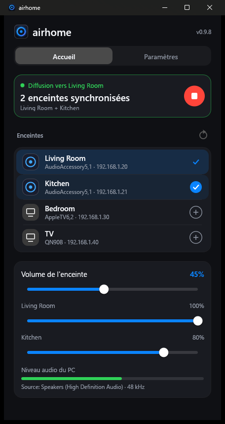
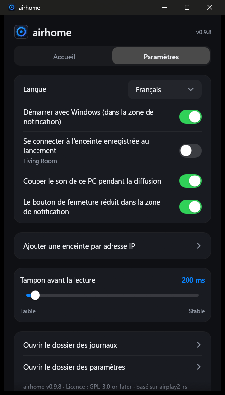

<p align="center">
  
</p>

<h1 align="center">airhome</h1>

<p align="center">
  <b>Le son de Windows sur votre HomePod, en un clic.</b><br>
  Une petite application gratuite de la zone de notification qui envoie tout ce que vous entendez sur le PC vers des enceintes AirPlay 2.
</p>

<p align="center">
  
  
  
  
</p>

<p align="center">
  <a href="README.md">English</a> ·
  <a href="README.ru.md">Русский</a> ·
  <a href="README.es.md">Español</a> ·
  <a href="README.de.md">Deutsch</a> ·
  <b>Français</b> ·
  <a href="README.pt.md">Português</a> ·
  <a href="README.zh.md">中文</a> ·
  <a href="README.ja.md">日本語</a>
</p>

<p align="center">
  
  &nbsp;&nbsp;
  
</p>

---

## Pourquoi airhome

Windows n'a aucun moyen intégré d'envoyer son son vers un HomePod. airhome en ajoute un qui fonctionne simplement :

- **Un clic, aucun pilote.** Pas de carte son virtuelle, pas de Bonjour, pas d'iTunes. Choisissez une enceinte, connectez.
- **Le son uniquement où vous le voulez.** Pendant la diffusion, les haut-parleurs du PC sont coupés puis rétablis ensuite
  — même si le programme se ferme de façon inattendue.
- **Plusieurs enceintes à la fois.** Touchez **+** à côté d'autres enceintes pour jouer sur toutes en synchronisation,
  chacune avec son propre volume *(expérimental)*.
- **Dans la zone de notification.** Connectez, déconnectez et réglez le volume depuis le menu, sans ouvrir la fenêtre.
- **Reste connecté.** Reconnexion automatique après une coupure Wi-Fi, nouvel essai si le démarrage est lent, bouton
  pour annuler une connexion trop longue et notification si un problème survient fenêtre masquée.
- **Petit et privé.** Un seul programme de 12 Mo, sans rien d'autre à installer. Pas de compte, pas de télémétrie,
  pas de recherche de mises à jour, pas de publicité. Open source.
- **Dans votre langue.** English, Русский, Español, Deutsch, Français, Português, 中文, 日本語.

## Fonctionnalités

| | |
|---|---|
| 🔊 **Audio du système** | Capture tout ce que Windows joue (WASAPI loopback) et l'envoie en audio AirPlay 2 chiffré |
| 🏠 **Compatible HomePod** | Appairage transitoire HomeKit, synchronisation PTP précise, fonctionne avec le HomePod mini |
| 🎚 **Volume** | Volume général et niveau propre à chaque enceinte ; réglable aussi depuis la zone de notification |
| ⏱ **Délai réglable** | Tampon de 100 à 2000 ms : plus bas = plus réactif, plus haut = plus stable avec un Wi-Fi faible |
| 🔌 **Ajout par IP et port** | Pour les réseaux où la détection automatique ne fonctionne pas (VLAN, certains routeurs) |
| 🔁 **Reconnexion automatique** | Rétablit le flux après une coupure ; la connexion peut être annulée à tout moment |
| 🔔 **Notifications** | Une notification Windows si une connexion échoue pendant qu'airhome est dans la zone de notification |
| 🚀 **Démarrage avec Windows** | Démarre si vous le souhaitez masqué et se connecte à votre enceinte enregistrée |
| 🌍 **8 langues** | Choisie automatiquement d'après Windows ; modifiable dans les réglages |

## Comment ça marche

```
  Son Windows ──►  capture  ──►  encodage (ALAC) + chiffrement  ──►  AirPlay 2  ──►  HomePod
  (ce que vous    (loopback)                                         (RTSP / RTP,
   entendez)                                                          horloge PTP)
```

airhome écoute le son que joue votre PC, le compresse sans perte, le chiffre et l'envoie à l'enceinte via votre
réseau local avec le protocole AirPlay 2. Quand plusieurs enceintes sont choisies, elles partagent une même horloge et
jouent en synchronisation. Pour éviter le son en double, la sortie propre du PC est coupée pendant la diffusion.

## Installation

1. Téléchargez **`airhome-setup-<version>.exe`** depuis la page [*Releases*](https://github.com/gmancode/airhome/releases/latest) et lancez-le (droits administrateur inutiles).
2. Choisissez la langue et les raccourcis voulus. Une entrée du menu Démarrer est toujours créée.
3. Quand il le demande, autorisez airhome dans le **Pare-feu Windows** pour les réseaux privés, sinon il n'y aura pas de son.

Prérequis : Windows 10 ou 11 (64 bits), un HomePod ou une autre enceinte AirPlay 2 sur le **même réseau**, accès AirPlay
réglé sur « Tout le monde sur le même réseau » et **aucun mot de passe AirPlay** sur l'enceinte.

## Prise en main

1. Ouvrez airhome. Vos enceintes apparaissent dans la liste.
2. Touchez une enceinte, puis le bouton rond **lecture**.
3. Fermez la fenêtre : airhome continue de jouer depuis la zone de notification. Clic droit sur l'icône : connecter, déconnecter, volume.

## Réglages

| Réglage | Effet |
|---|---|
| Langue | Langue de l'interface |
| Démarrer avec Windows | Démarre masqué dans la zone de notification à l'ouverture de session |
| Se connecter à l'enceinte enregistrée au lancement | Connexion automatique ; le nom de l'enceinte s'affiche sous l'interrupteur |
| Couper le son de ce PC pendant la diffusion | Évite le son en double ; rétabli automatiquement ensuite |
| Le bouton de fermeture réduit dans la zone de notification | Laisse airhome tourner en arrière-plan |
| Ajouter une enceinte par adresse IP | Ajoute une enceinte à la main (IP et port facultatif, 7000 par défaut) |
| Tampon avant la lecture | Curseur de latence, 100–2000 ms (appliqué à la prochaine connexion) |

## Conseils

- **L'enceinte n'apparaît pas ?** Vérifiez qu'elle est sur le même réseau et actualisez. Si votre réseau bloque la
  détection, utilisez *Ajouter une enceinte par adresse IP*.
- **Pas de son ?** Vérifiez que le Pare-feu Windows autorise airhome sur les réseaux privés et que l'enceinte n'a pas de
  mot de passe AirPlay. Des filtres réseau (par exemple le pilote réseau d'AdGuard) peuvent bloquer la connexion.
- **Le délai compte (vidéo, jeux) ?** Réduisez le tampon. AirPlay ajoute toujours un peu de délai ; pour une vidéo
  synchronisée avec l'image, un petit tampon est préférable.
- **Coupures avec un Wi-Fi faible ?** Augmentez le tampon.

## État

Développé et testé sous Windows 11 avec un HomePod mini. Windows 10 devrait fonctionner mais n'a pas été testé. La lecture
sur plusieurs enceintes est **expérimentale**. Il n'existe pas encore de version native pour Windows sur ARM ni pour Linux
(la version x64 s'exécute sur ARM via l'émulation de Windows, non testé).

## Le logo

<p align="center">
  
  &nbsp;
  
  &nbsp;
  
</p>

Un anneau lumineux avec un point au centre : le son d'une enceinte qui rayonne depuis une seule source. L'anneau reflète
ce que fait airhome dans la zone de notification : **bleu-violet** au repos, **ambre** pendant la connexion, **vert** pendant la diffusion.

## Compiler depuis les sources

Prérequis : Windows, Rust (chaîne MSVC). Ce dépôt contient à la fois l'application (`airhome/`) et la bibliothèque
`airplay2-rs` modifiée (`airplay2-rs/`) : rien d'autre à télécharger.

```
cd airhome
cargo build --release
```

L'exécutable est `target\release\airhome.exe`. Pour créer l'installateur, installez
[Inno Setup 6](https://jrsoftware.org/isinfo.php) et lancez `iscc /DAppVersion=<version> installer\airhome.iss`.

## Licence

GPL-3.0-or-later — voir [`LICENSE`](LICENSE) et [`NOTICE.md`](airhome/NOTICE.md). Fondé sur
[airplay2-rs](https://github.com/lmcgartland/airplay2-rs).

« AirPlay », « HomePod » et « Apple » sont des marques d'Apple Inc. airhome est un projet indépendant, non affilié à
Apple et non approuvé par Apple.
