<p align="center">
  
</p>

<h1 align="center">airhome</h1>

<p align="center">
  <b>Play your Windows sound on a HomePod — in one click.</b><br>
  <b>Звук Windows на HomePod — в один клик.</b>
</p>

<p align="center">
  
  
  
  
  <a href="https://github.com/gmancode/airhome/releases/latest"></a>
</p>

<p align="center">
  🇬🇧 <b>English</b> and 🇷🇺 <b>Русский</b> are shown below · other languages are folded — click one to expand it<br>
  🇬🇧 <b>English</b> и 🇷🇺 <b>Русский</b> ниже · остальные языки свёрнуты — нажмите, чтобы раскрыть
</p>

<p align="center">
  
  &nbsp;&nbsp;
  
</p>

---

<details open>
<summary><h2>🇬🇧 English</h2></summary>

<p align="center">
  
  &nbsp;&nbsp;
  
</p>

---
## Why airhome

Windows has no built-in way to send its sound to a HomePod. airhome adds one that just works:

- **One click, no drivers.** No virtual sound card, no Bonjour, no iTunes. Pick a speaker, press connect.
- **Sound only where you want it.** While streaming, your PC's own speakers are muted and restored afterwards
  — even if the program is closed unexpectedly.
- **Several speakers at once.** Tap **+** next to more speakers to play on all of them in sync, each with its
  own volume *(experimental)*.
- **Lives in the tray.** Connect, disconnect and change the volume from the tray menu without opening the window.
- **Stays connected.** Automatic reconnect after a Wi-Fi hiccup, a retry on a slow start, a button to cancel a
  connection that takes too long, and a notification if something goes wrong while the window is hidden.
- **Small and private.** One 12 MB program with no extra runtime to install. No account, no telemetry, no
  update pings, no ads. Open source.
- **Speaks your language.** English, Русский, Español, Deutsch, Français, Português, 中文, 日本語.

## Features

| | |
|---|---|
| 🔊 **System audio** | Captures everything Windows plays (WASAPI loopback) and sends it as encrypted AirPlay 2 audio |
| 🏠 **HomePod friendly** | HomeKit transient pairing, accurate PTP timing, works with HomePod mini |
| 🎚 **Volume** | Master volume plus a separate level for every speaker; also controllable from the tray |
| ⏱ **Adjustable delay** | Buffer from 100 to 2000 ms: lower is more immediate, higher is steadier on weak Wi-Fi |
| 🔌 **Add by IP and port** | For networks where automatic discovery does not work (VLANs, some routers) |
| 🔁 **Auto reconnect** | Brings the stream back after the connection drops; connecting can be cancelled at any time |
| 🔔 **Notifications** | A Windows notification if a connection fails while airhome is in the tray |
| 🚀 **Start with Windows** | Optionally starts hidden in the tray and connects to your saved speaker |
| 🌍 **8 languages** | Picked automatically from Windows; change it in Settings |

## How it works

```
  Windows sound ──►  capture  ──►  encode (ALAC) + encrypt  ──►  AirPlay 2  ──►  HomePod
  (what you hear)    (loopback)                                   (RTSP / RTP,
                                                                   PTP clock)
```

airhome listens to the sound your PC is playing, compresses it losslessly, encrypts it and streams it to the
speaker over your local network using the AirPlay 2 protocol. When several speakers are selected, they share one
clock so they play in sync. To avoid doubled sound, the PC's own output is muted while the stream runs.

## Install

1. Download **`airhome-setup-<version>.exe`** from the [*Releases*](https://github.com/gmancode/airhome/releases/latest) page and run it (no administrator rights needed).
2. Pick your language and the shortcuts you want. A Start menu entry is always created.
3. Allow airhome through **Windows Firewall** for private networks when asked — otherwise there is no sound.

Requirements: Windows 10 or 11 (64-bit), a HomePod or another AirPlay 2 speaker on the **same network**, AirPlay
access set to "Everyone on the same network" and **no AirPlay password** on the speaker.

## Quick start

1. Open airhome. Your speakers appear in the list.
2. Tap a speaker, then press the round **play** button.
3. Close the window — airhome keeps playing from the tray. Right-click the tray icon for connect / disconnect and volume.

## Settings

| Setting | What it does |
|---|---|
| Language | Interface language |
| Start with Windows | Starts hidden in the tray when you sign in |
| Connect to the saved speaker on launch | Connects automatically; the speaker's name is shown under the switch |
| Mute this PC's speakers while streaming | Prevents doubled sound; restored automatically afterwards |
| Close button minimizes to the tray | Keeps airhome running in the background |
| Add speaker by IP address | Adds a speaker manually (IP and optional port, default 7000) |
| Buffer before playback | Latency slider, 100–2000 ms (applies on the next connection) |

## Tips

- **Speaker not in the list?** Check it is on the same network, then press refresh. If your network blocks
  discovery, use *Add speaker by IP address*.
- **No sound?** Make sure Windows Firewall allows airhome on private networks, and that the speaker has no AirPlay
  password. Network filters (for example AdGuard's network driver) can block the connection.
- **Delay matters (video, games)?** Lower the buffer. AirPlay always adds some delay of its own, so for
  lip-sync-critical video a small buffer is best.
- **Choppy on weak Wi-Fi?** Raise the buffer.

## Status

Developed and tested on Windows 11 with a HomePod mini. Windows 10 is expected to work but has not been tested.
Playing on several speakers is **experimental**. Native Windows-on-ARM and Linux builds do not exist yet (the
x64 build runs on ARM with Windows' emulation, untested).

## The logo

<p align="center">
  
  &nbsp;
  
  &nbsp;
  
</p>

A glowing ring with a point at its centre — a speaker's sound radiating from a single source. The ring follows what
airhome is doing in the tray: **blue-violet** when idle, **amber** while connecting, **green** while streaming.

## Build from source

Requirements: Windows, Rust (MSVC toolchain). This repository contains both the application (`airhome/`) and the
modified `airplay2-rs` library (`airplay2-rs/`), so there is nothing else to download.

```
cd airhome
cargo build --release
```

The executable is `target\release\airhome.exe`. To build the installer, install
[Inno Setup 6](https://jrsoftware.org/isinfo.php) and run `iscc /DAppVersion=<version> installer\airhome.iss`.

## License

GPL-3.0-or-later — see [`LICENSE`](LICENSE) and [`NOTICE.md`](airhome/NOTICE.md). Built on
[airplay2-rs](https://github.com/lmcgartland/airplay2-rs).

"AirPlay", "HomePod" and "Apple" are trademarks of Apple Inc. airhome is an independent project and is not
affiliated with or endorsed by Apple.

</details>

<details open>
<summary><h2>🇷🇺 Русский</h2></summary>

<p align="center">
  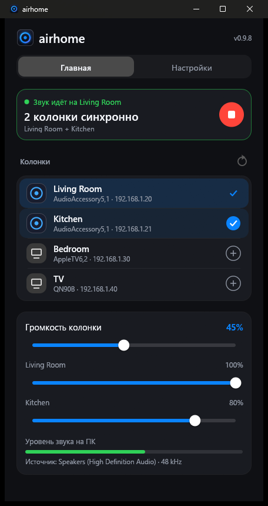
  &nbsp;&nbsp;
  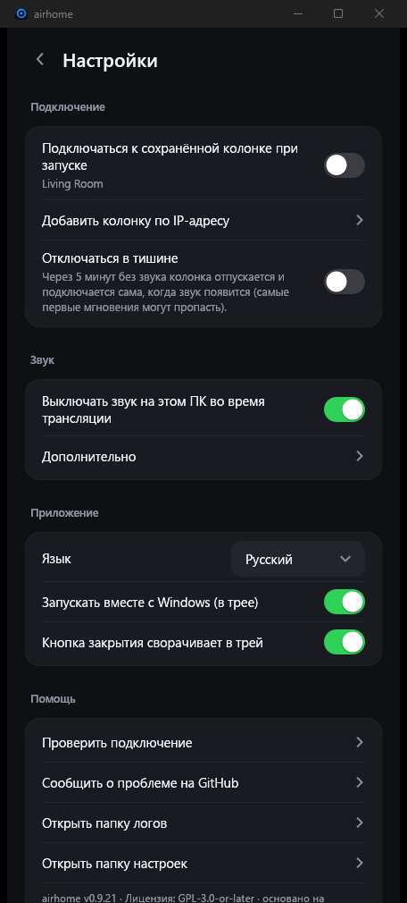
</p>

---
## Почему airhome

В Windows нет встроенного способа отправить звук на HomePod. airhome добавляет его, и он просто работает:

- **Один клик, без драйверов.** Никаких виртуальных звуковых карт, Bonjour и iTunes. Выберите колонку и нажмите «Подключиться».
- **Звук только там, где нужно.** Пока идёт трансляция, колонки компьютера выключены, а потом звук возвращается
  — даже если программа закрылась неожиданно.
- **Несколько колонок сразу.** Нажмите **+** у других колонок, и они заиграют синхронно, у каждой своя
  громкость *(экспериментально)*.
- **Живёт в трее.** Подключение, отключение и громкость доступны из меню в трее, окно открывать не нужно.
- **Не теряет связь.** Автоматическое переподключение после сбоя Wi-Fi, повтор при медленном старте, кнопка отмены
  слишком долгого подключения и уведомление, если что-то пошло не так, пока окно спрятано.
- **Маленькая и приватная.** Одна программа на 12 МБ, ничего дополнительно ставить не нужно. Без аккаунта,
  без телеметрии, без проверок обновлений, без рекламы. Открытый исходный код.
- **На вашем языке.** English, Русский, Español, Deutsch, Français, Português, 中文, 日本語.

## Возможности

| | |
|---|---|
| 🔊 **Звук системы** | Перехватывает всё, что играет Windows (WASAPI loopback), и отправляет зашифрованным потоком AirPlay 2 |
| 🏠 **Дружит с HomePod** | Транзитное сопряжение HomeKit, точная синхронизация PTP, работает с HomePod mini |
| 🎚 **Громкость** | Общая громкость и отдельный уровень каждой колонки; управляется и из трея |
| ⏱ **Настраиваемая задержка** | Буфер от 100 до 2000 мс: меньше — отклик быстрее, больше — стабильнее на слабом Wi-Fi |
| 🔌 **Добавление по IP и порту** | Для сетей, где автоматический поиск не работает (VLAN, некоторые роутеры) |
| 🔁 **Автопереподключение** | Возвращает поток после обрыва связи; подключение можно отменить в любой момент |
| 🔔 **Уведомления** | Уведомление Windows, если подключение не удалось, пока airhome в трее |
| 🚀 **Запуск с Windows** | При желании стартует скрытно в трее и подключается к сохранённой колонке |
| 🌍 **8 языков** | Определяется автоматически по Windows; меняется в настройках |

## Как это работает

```
  Звук Windows ──►  захват  ──►  кодирование (ALAC) + шифрование  ──►  AirPlay 2  ──►  HomePod
  (то, что вы слышите) (loopback)                                      (RTSP / RTP,
                                                                        часы PTP)
```

airhome слушает звук, который играет ваш компьютер, сжимает его без потерь, шифрует и отправляет на колонку по
локальной сети по протоколу AirPlay 2. Если выбрано несколько колонок, у них общие часы, поэтому они играют
синхронно. Чтобы звук не удваивался, собственный вывод компьютера на время трансляции отключается.

## Установка

1. Скачайте **`airhome-setup-<версия>.exe`** на странице [*Releases*](https://github.com/gmancode/airhome/releases/latest) и запустите (права администратора не нужны).
2. Выберите язык и нужные ярлыки. Запись в меню «Пуск» создаётся всегда.
3. Когда спросит **брандмауэр Windows**, разрешите airhome частные сети, иначе звука не будет.

Требования: Windows 10 или 11 (64-бит), HomePod или другая колонка AirPlay 2 в **той же сети**, в доступе AirPlay
выбрано «Все в той же сети» и на колонке **нет пароля AirPlay**.

## Быстрый старт

1. Откройте airhome. В списке появятся ваши колонки.
2. Нажмите колонку, затем круглую кнопку **play**.
3. Закройте окно — airhome продолжит играть из трея. Правый клик по значку открывает меню: подключение, отключение, громкость.

## Настройки

| Настройка | Что делает |
|---|---|
| Язык | Язык интерфейса |
| Запускать вместе с Windows | Стартует скрытно в трее при входе в систему |
| Подключаться к сохранённой колонке при запуске | Подключается автоматически; имя колонки показано под переключателем |
| Выключать звук на этом ПК во время трансляции | Не даёт звуку удваиваться; потом включается обратно сам |
| Кнопка закрытия сворачивает в трей | Программа продолжает работать в фоне |
| Добавить колонку по IP-адресу | Добавляет колонку вручную (IP и необязательный порт, по умолчанию 7000) |
| Буфер перед воспроизведением | Ползунок задержки, 100–2000 мс (применяется при следующем подключении) |

## Советы

- **Колонки нет в списке?** Проверьте, что она в той же сети, и нажмите «Обновить». Если сеть блокирует поиск,
  воспользуйтесь «Добавить колонку по IP-адресу».
- **Нет звука?** Убедитесь, что брандмауэр Windows разрешает airhome частные сети и что на колонке нет пароля
  AirPlay. Сетевые фильтры (например, сетевой драйвер AdGuard) могут блокировать подключение.
- **Важна задержка (видео, игры)?** Уменьшите буфер. AirPlay всегда добавляет свою задержку, поэтому для видео, где
  важна синхронизация с картинкой, лучше маленький буфер.
- **Прерывается на слабом Wi-Fi?** Увеличьте буфер.

## Статус

Разработана и проверена на Windows 11 с HomePod mini. Windows 10 должна работать, но не проверялась. Игра на нескольких
колонках **экспериментальная**. Родных сборок для Windows на ARM и Linux пока нет (сборка x64 запускается на ARM
через эмуляцию Windows, не проверено).

## Логотип

<p align="center">
  
  &nbsp;
  
  &nbsp;
  
</p>

Светящееся кольцо с точкой в центре: звук колонки, расходящийся из одного источника. Кольцо в трее показывает, что
делает airhome: **сине-фиолетовое**, когда ничего не идёт, **янтарное** при подключении, **зелёное** во время трансляции.

## Сборка из исходников

Нужны: Windows, Rust (набор инструментов MSVC). В этом репозитории лежат и приложение (`airhome/`), и изменённая
библиотека `airplay2-rs` (`airplay2-rs/`), так что ничего больше скачивать не нужно.

```
cd airhome
cargo build --release
```

Исполняемый файл: `target\release\airhome.exe`. Чтобы собрать установщик, установите
[Inno Setup 6](https://jrsoftware.org/isinfo.php) и выполните `iscc /DAppVersion=<версия> installer\airhome.iss`.

## Лицензия

GPL-3.0-or-later — см. [`LICENSE`](LICENSE) и [`NOTICE.md`](airhome/NOTICE.md). Основано на
[airplay2-rs](https://github.com/lmcgartland/airplay2-rs).

«AirPlay», «HomePod» и «Apple» — товарные знаки Apple Inc. airhome — независимый проект, не связан с Apple и не
одобрен ею.

</details>

<details>
<summary><h2>🇪🇸 Español</h2></summary>

<p align="center">
  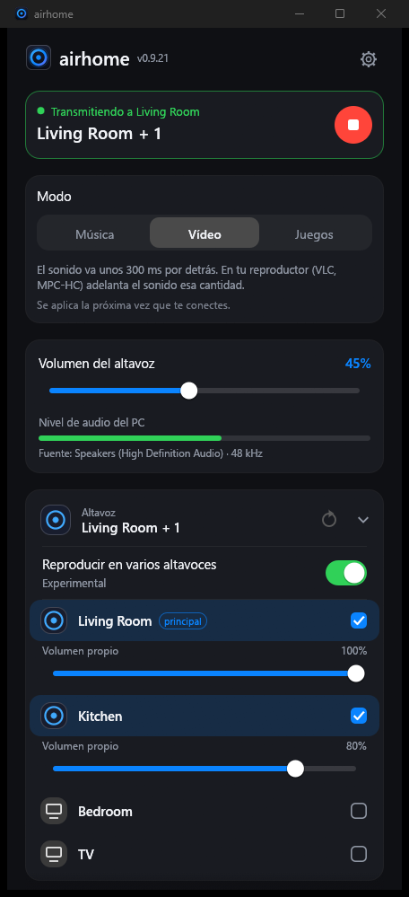
  &nbsp;&nbsp;
  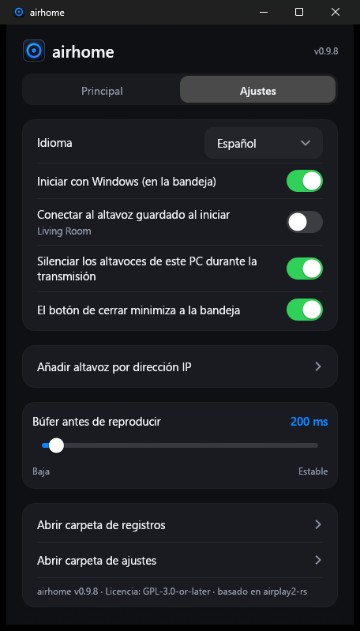
</p>

---
## Por qué airhome

Windows no tiene una forma integrada de enviar su sonido a un HomePod. airhome añade una que simplemente funciona:

- **Un clic, sin controladores.** Sin tarjeta de sonido virtual, sin Bonjour, sin iTunes. Elige un altavoz y pulsa conectar.
- **El sonido solo donde quieres.** Mientras transmite, los altavoces del PC se silencian y se restauran después
  — incluso si el programa se cierra de forma inesperada.
- **Varios altavoces a la vez.** Pulsa **+** junto a otros altavoces para reproducir en todos en sincronía, cada uno
  con su propio volumen *(experimental)*.
- **Vive en la bandeja.** Conecta, desconecta y cambia el volumen desde el menú de la bandeja sin abrir la ventana.
- **Se mantiene conectado.** Reconexión automática tras un fallo de Wi-Fi, un reintento si el inicio es lento, un botón
  para cancelar una conexión que tarda demasiado y una notificación si algo falla con la ventana oculta.
- **Pequeño y privado.** Un solo programa de 12 MB sin nada más que instalar. Sin cuenta, sin telemetría, sin
  comprobaciones de actualización, sin anuncios. Código abierto.
- **En tu idioma.** English, Русский, Español, Deutsch, Français, Português, 中文, 日本語.

## Características

| | |
|---|---|
| 🔊 **Audio del sistema** | Captura todo lo que reproduce Windows (WASAPI loopback) y lo envía como audio AirPlay 2 cifrado |
| 🏠 **Compatible con HomePod** | Emparejamiento transitorio de HomeKit, sincronización PTP precisa, funciona con HomePod mini |
| 🎚 **Volumen** | Volumen general más un nivel independiente para cada altavoz; también desde la bandeja |
| ⏱ **Retardo ajustable** | Búfer de 100 a 2000 ms: más bajo es más inmediato, más alto es más estable con Wi-Fi débil |
| 🔌 **Añadir por IP y puerto** | Para redes donde la detección automática no funciona (VLAN, algunos routers) |
| 🔁 **Reconexión automática** | Recupera la transmisión tras una caída; la conexión se puede cancelar en cualquier momento |
| 🔔 **Notificaciones** | Una notificación de Windows si falla una conexión mientras airhome está en la bandeja |
| 🚀 **Inicio con Windows** | Opcionalmente arranca oculto en la bandeja y se conecta a tu altavoz guardado |
| 🌍 **8 idiomas** | Se elige automáticamente según Windows; se cambia en Ajustes |

## Cómo funciona

```
  Sonido de Windows ──►  captura  ──►  codificar (ALAC) + cifrar  ──►  AirPlay 2  ──►  HomePod
  (lo que oyes)          (loopback)                                    (RTSP / RTP,
                                                                        reloj PTP)
```

airhome escucha el sonido que reproduce tu PC, lo comprime sin pérdida, lo cifra y lo transmite al altavoz por la
red local con el protocolo AirPlay 2. Si hay varios altavoces seleccionados, comparten un mismo reloj y suenan en
sincronía. Para evitar el sonido duplicado, la salida propia del PC se silencia mientras dura la transmisión.

## Instalación

1. Descarga **`airhome-setup-<versión>.exe`** desde la página [*Releases*](https://github.com/gmancode/airhome/releases/latest) y ejecútalo (no requiere administrador).
2. Elige el idioma y los accesos directos que quieras. La entrada del menú Inicio se crea siempre.
3. Cuando lo pida, permite airhome en el **Firewall de Windows** para redes privadas; si no, no habrá sonido.

Requisitos: Windows 10 u 11 (64 bits), un HomePod u otro altavoz AirPlay 2 en la **misma red**, el acceso AirPlay en
«Todos en la misma red» y **sin contraseña de AirPlay** en el altavoz.

## Inicio rápido

1. Abre airhome. Tus altavoces aparecen en la lista.
2. Toca un altavoz y pulsa el botón redondo de **reproducir**.
3. Cierra la ventana: airhome sigue sonando desde la bandeja. Clic derecho en el icono para conectar, desconectar y volumen.

## Ajustes

| Ajuste | Qué hace |
|---|---|
| Idioma | Idioma de la interfaz |
| Iniciar con Windows | Arranca oculto en la bandeja al iniciar sesión |
| Conectar al altavoz guardado al iniciar | Se conecta solo; el nombre del altavoz aparece bajo el interruptor |
| Silenciar los altavoces de este PC durante la transmisión | Evita el sonido duplicado; se restaura solo después |
| El botón de cierre minimiza a la bandeja | Mantiene airhome en segundo plano |
| Añadir altavoz por dirección IP | Añade un altavoz a mano (IP y puerto opcional, por defecto 7000) |
| Búfer antes de reproducir | Control de latencia, 100–2000 ms (se aplica en la siguiente conexión) |

## Consejos

- **¿No aparece el altavoz?** Comprueba que está en la misma red y pulsa actualizar. Si tu red bloquea la
  detección, usa *Añadir altavoz por dirección IP*.
- **¿Sin sonido?** Asegúrate de que el Firewall de Windows permite airhome en redes privadas y de que el altavoz no
  tiene contraseña de AirPlay. Los filtros de red (por ejemplo, el controlador de red de AdGuard) pueden bloquear la conexión.
- **¿Importa el retardo (vídeo, juegos)?** Reduce el búfer. AirPlay siempre añade algo de retardo propio, así que
  para vídeo con sincronía labial conviene un búfer pequeño.
- **¿Cortes con Wi-Fi débil?** Aumenta el búfer.

## Estado

Desarrollado y probado en Windows 11 con un HomePod mini. Se espera que Windows 10 funcione, pero no se ha probado.
Reproducir en varios altavoces es **experimental**. Aún no hay compilaciones nativas para Windows en ARM ni Linux
(la versión x64 se ejecuta en ARM mediante la emulación de Windows, sin probar).

## El logotipo

<p align="center">
  
  &nbsp;
  
  &nbsp;
  
</p>

Un anillo luminoso con un punto en el centro: el sonido de un altavoz que se irradia desde una sola fuente. El anillo
refleja lo que hace airhome en la bandeja: **azul violeta** en reposo, **ámbar** al conectar y **verde** al transmitir.

## Compilar desde el código fuente

Requisitos: Windows, Rust (cadena MSVC). Este repositorio contiene tanto la aplicación (`airhome/`) como la
biblioteca `airplay2-rs` modificada (`airplay2-rs/`), así que no hay que descargar nada más.

```
cd airhome
cargo build --release
```

El ejecutable es `target\release\airhome.exe`. Para crear el instalador, instala
[Inno Setup 6](https://jrsoftware.org/isinfo.php) y ejecuta `iscc /DAppVersion=<versión> installer\airhome.iss`.

## Licencia

GPL-3.0-or-later — consulta [`LICENSE`](LICENSE) y [`NOTICE.md`](airhome/NOTICE.md). Basado en
[airplay2-rs](https://github.com/lmcgartland/airplay2-rs).

«AirPlay», «HomePod» y «Apple» son marcas registradas de Apple Inc. airhome es un proyecto independiente, sin
afiliación ni respaldo de Apple.

</details>

<details>
<summary><h2>🇩🇪 Deutsch</h2></summary>

<p align="center">
  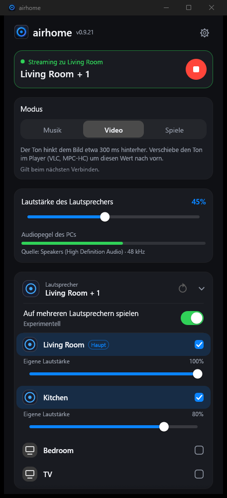
  &nbsp;&nbsp;
  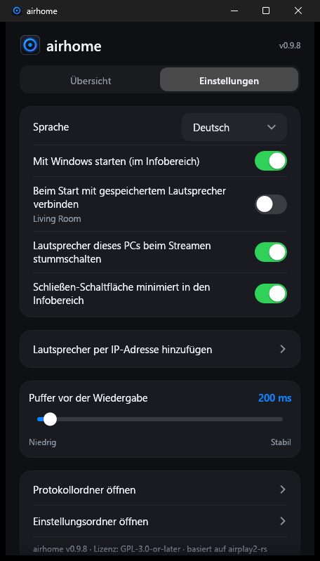
</p>

---
## Warum airhome

Windows kann seinen Ton nicht von Haus aus an einen HomePod senden. airhome ergänzt genau das – und es funktioniert einfach:

- **Ein Klick, keine Treiber.** Keine virtuelle Soundkarte, kein Bonjour, kein iTunes. Lautsprecher wählen, verbinden.
- **Ton nur dort, wo du ihn willst.** Beim Streamen werden die PC-Lautsprecher stummgeschaltet und danach wiederhergestellt
  – auch wenn das Programm unerwartet beendet wird.
- **Mehrere Lautsprecher gleichzeitig.** Tippe bei weiteren Lautsprechern auf **+**, um alle synchron abzuspielen, jeder
  mit eigener Lautstärke *(experimentell)*.
- **Lebt im Tray.** Verbinden, trennen und Lautstärke ändern direkt im Tray-Menü, ohne das Fenster zu öffnen.
- **Bleibt verbunden.** Automatische Wiederverbindung nach einem WLAN-Aussetzer, ein erneuter Versuch bei langsamem Start,
  ein Knopf zum Abbrechen einer zu langen Verbindung und eine Benachrichtigung, wenn bei verstecktem Fenster etwas schiefgeht.
- **Klein und privat.** Ein einziges 12-MB-Programm ohne zusätzliche Laufzeitumgebung. Kein Konto, keine Telemetrie,
  keine Update-Abfragen, keine Werbung. Open Source.
- **In deiner Sprache.** English, Русский, Español, Deutsch, Français, Português, 中文, 日本語.

## Funktionen

| | |
|---|---|
| 🔊 **Systemton** | Erfasst alles, was Windows abspielt (WASAPI-Loopback), und sendet es als verschlüsseltes AirPlay-2-Audio |
| 🏠 **HomePod-tauglich** | HomeKit-Transient-Pairing, präzise PTP-Zeitsynchronisation, funktioniert mit HomePod mini |
| 🎚 **Lautstärke** | Gesamtlautstärke plus eigener Pegel für jeden Lautsprecher; auch über das Tray bedienbar |
| ⏱ **Einstellbare Verzögerung** | Puffer von 100 bis 2000 ms: niedriger = direkter, höher = stabiler bei schwachem WLAN |
| 🔌 **Hinzufügen per IP und Port** | Für Netzwerke, in denen die automatische Suche nicht funktioniert (VLANs, manche Router) |
| 🔁 **Automatische Wiederverbindung** | Holt den Stream nach einem Abbruch zurück; Verbinden lässt sich jederzeit abbrechen |
| 🔔 **Benachrichtigungen** | Eine Windows-Benachrichtigung, wenn eine Verbindung scheitert, während airhome im Tray läuft |
| 🚀 **Start mit Windows** | Startet auf Wunsch versteckt im Tray und verbindet sich mit deinem gespeicherten Lautsprecher |
| 🌍 **8 Sprachen** | Wird automatisch aus Windows übernommen; in den Einstellungen änderbar |

## So funktioniert es

```
  Windows-Ton ──►  Erfassung  ──►  Kodierung (ALAC) + Verschlüsselung  ──►  AirPlay 2  ──►  HomePod
  (was du hörst)   (Loopback)                                              (RTSP / RTP,
                                                                            PTP-Takt)
```

airhome hört den Ton mit, den dein PC abspielt, komprimiert ihn verlustfrei, verschlüsselt ihn und streamt ihn über
dein lokales Netzwerk per AirPlay-2-Protokoll an den Lautsprecher. Sind mehrere Lautsprecher gewählt, teilen sie
sich einen Takt und spielen synchron. Damit der Ton nicht doppelt erklingt, wird die eigene Ausgabe des PCs während
des Streams stummgeschaltet.

## Installation

1. Lade **`airhome-setup-<Version>.exe`** von der Seite [*Releases*](https://github.com/gmancode/airhome/releases/latest) herunter und starte sie (keine Administratorrechte nötig).
2. Wähle Sprache und gewünschte Verknüpfungen. Ein Startmenü-Eintrag wird immer angelegt.
3. Erlaube airhome in der **Windows-Firewall** für private Netzwerke, wenn danach gefragt wird – sonst gibt es keinen Ton.

Voraussetzungen: Windows 10 oder 11 (64 Bit), ein HomePod oder anderer AirPlay-2-Lautsprecher im **selben Netzwerk**,
AirPlay-Zugriff auf „Alle im selben Netzwerk“ und **kein AirPlay-Passwort** am Lautsprecher.

## Schnellstart

1. Öffne airhome. Deine Lautsprecher erscheinen in der Liste.
2. Tippe einen Lautsprecher an und drücke den runden **Play**-Knopf.
3. Schließe das Fenster – airhome spielt im Tray weiter. Rechtsklick auf das Tray-Symbol: Verbinden, Trennen, Lautstärke.

## Einstellungen

| Einstellung | Wirkung |
|---|---|
| Sprache | Sprache der Oberfläche |
| Mit Windows starten | Startet beim Anmelden versteckt im Tray |
| Beim Start mit gespeichertem Lautsprecher verbinden | Verbindet automatisch; der Name steht unter dem Schalter |
| Lautsprecher dieses PCs beim Streamen stummschalten | Verhindert doppelten Ton; wird danach automatisch wiederhergestellt |
| Schließen-Schaltfläche minimiert in den Infobereich | Hält airhome im Hintergrund am Laufen |
| Lautsprecher per IP-Adresse hinzufügen | Fügt einen Lautsprecher manuell hinzu (IP und optionaler Port, Standard 7000) |
| Puffer vor der Wiedergabe | Latenz-Regler, 100–2000 ms (gilt ab der nächsten Verbindung) |

## Tipps

- **Lautsprecher fehlt in der Liste?** Prüfe, ob er im selben Netzwerk ist, und drücke Aktualisieren. Blockiert dein
  Netzwerk die Suche, nutze *Lautsprecher per IP-Adresse hinzufügen*.
- **Kein Ton?** Stelle sicher, dass die Windows-Firewall airhome in privaten Netzwerken erlaubt und der Lautsprecher kein
  AirPlay-Passwort hat. Netzwerkfilter (z. B. der Netzwerktreiber von AdGuard) können die Verbindung blockieren.
- **Verzögerung wichtig (Video, Spiele)?** Verkleinere den Puffer. AirPlay bringt immer etwas eigene Verzögerung mit;
  für lippensynchrones Video ist ein kleiner Puffer am besten.
- **Aussetzer bei schwachem WLAN?** Vergrößere den Puffer.

## Status

Entwickelt und getestet unter Windows 11 mit einem HomePod mini. Windows 10 sollte funktionieren, wurde aber nicht
getestet. Das Abspielen auf mehreren Lautsprechern ist **experimentell**. Native Builds für Windows auf ARM und Linux
gibt es noch nicht (der x64-Build läuft auf ARM über die Windows-Emulation, ungetestet).

## Das Logo

<p align="center">
  
  &nbsp;
  
  &nbsp;
  
</p>

Ein leuchtender Ring mit einem Punkt in der Mitte – der Klang eines Lautsprechers, der von einer einzigen Quelle ausstrahlt.
Der Ring zeigt im Tray, was airhome gerade tut: **blau-violett** im Leerlauf, **bernsteinfarben** beim Verbinden,
**grün** beim Streamen.

## Aus dem Quellcode bauen

Voraussetzungen: Windows, Rust (MSVC-Toolchain). Dieses Repository enthält sowohl die Anwendung (`airhome/`) als auch
die angepasste Bibliothek `airplay2-rs` (`airplay2-rs/`) – es muss nichts weiter heruntergeladen werden.

```
cd airhome
cargo build --release
```

Die ausführbare Datei ist `target\release\airhome.exe`. Für den Installer installiere
[Inno Setup 6](https://jrsoftware.org/isinfo.php) und führe `iscc /DAppVersion=<Version> installer\airhome.iss` aus.

## Lizenz

GPL-3.0-or-later – siehe [`LICENSE`](LICENSE) und [`NOTICE.md`](airhome/NOTICE.md). Basiert auf
[airplay2-rs](https://github.com/lmcgartland/airplay2-rs).

„AirPlay“, „HomePod“ und „Apple“ sind Marken von Apple Inc. airhome ist ein unabhängiges Projekt und weder mit Apple
verbunden noch von Apple unterstützt.

</details>

<details>
<summary><h2>🇫🇷 Français</h2></summary>

<p align="center">
  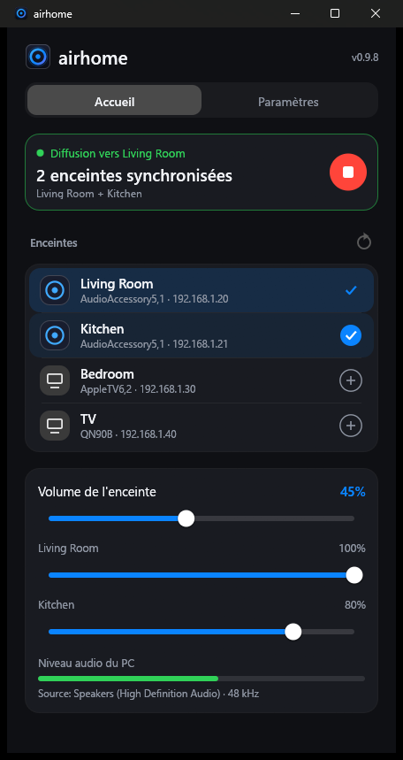
  &nbsp;&nbsp;
  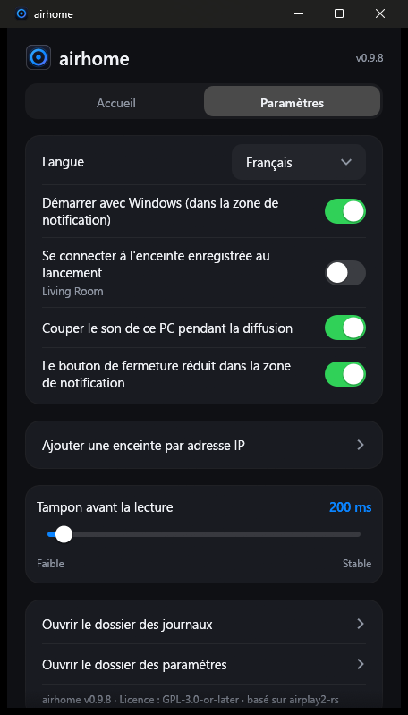
</p>

---
## Pourquoi airhome

Windows n'a aucun moyen intégré d'envoyer son son vers un HomePod. airhome en ajoute un qui fonctionne simplement :

- **Un clic, aucun pilote.** Pas de carte son virtuelle, pas de Bonjour, pas d'iTunes. Choisissez une enceinte, connectez.
- **Le son uniquement où vous le voulez.** Pendant la diffusion, les haut-parleurs du PC sont coupés puis rétablis ensuite
  — même si le programme se ferme de façon inattendue.
- **Plusieurs enceintes à la fois.** Touchez **+** à côté d'autres enceintes pour jouer sur toutes en synchronisation,
  chacune avec son propre volume *(expérimental)*.
- **Dans la zone de notification.** Connectez, déconnectez et réglez le volume depuis le menu, sans ouvrir la fenêtre.
- **Reste connecté.** Reconnexion automatique après une coupure Wi-Fi, nouvel essai si le démarrage est lent, bouton
  pour annuler une connexion trop longue et notification si un problème survient fenêtre masquée.
- **Petit et privé.** Un seul programme de 12 Mo, sans rien d'autre à installer. Pas de compte, pas de télémétrie,
  pas de recherche de mises à jour, pas de publicité. Open source.
- **Dans votre langue.** English, Русский, Español, Deutsch, Français, Português, 中文, 日本語.

## Fonctionnalités

| | |
|---|---|
| 🔊 **Audio du système** | Capture tout ce que Windows joue (WASAPI loopback) et l'envoie en audio AirPlay 2 chiffré |
| 🏠 **Compatible HomePod** | Appairage transitoire HomeKit, synchronisation PTP précise, fonctionne avec le HomePod mini |
| 🎚 **Volume** | Volume général et niveau propre à chaque enceinte ; réglable aussi depuis la zone de notification |
| ⏱ **Délai réglable** | Tampon de 100 à 2000 ms : plus bas = plus réactif, plus haut = plus stable avec un Wi-Fi faible |
| 🔌 **Ajout par IP et port** | Pour les réseaux où la détection automatique ne fonctionne pas (VLAN, certains routeurs) |
| 🔁 **Reconnexion automatique** | Rétablit le flux après une coupure ; la connexion peut être annulée à tout moment |
| 🔔 **Notifications** | Une notification Windows si une connexion échoue pendant qu'airhome est dans la zone de notification |
| 🚀 **Démarrage avec Windows** | Démarre si vous le souhaitez masqué et se connecte à votre enceinte enregistrée |
| 🌍 **8 langues** | Choisie automatiquement d'après Windows ; modifiable dans les réglages |

## Comment ça marche

```
  Son Windows ──►  capture  ──►  encodage (ALAC) + chiffrement  ──►  AirPlay 2  ──►  HomePod
  (ce que vous    (loopback)                                         (RTSP / RTP,
   entendez)                                                          horloge PTP)
```

airhome écoute le son que joue votre PC, le compresse sans perte, le chiffre et l'envoie à l'enceinte via votre
réseau local avec le protocole AirPlay 2. Quand plusieurs enceintes sont choisies, elles partagent une même horloge et
jouent en synchronisation. Pour éviter le son en double, la sortie propre du PC est coupée pendant la diffusion.

## Installation

1. Téléchargez **`airhome-setup-<version>.exe`** depuis la page [*Releases*](https://github.com/gmancode/airhome/releases/latest) et lancez-le (droits administrateur inutiles).
2. Choisissez la langue et les raccourcis voulus. Une entrée du menu Démarrer est toujours créée.
3. Quand il le demande, autorisez airhome dans le **Pare-feu Windows** pour les réseaux privés, sinon il n'y aura pas de son.

Prérequis : Windows 10 ou 11 (64 bits), un HomePod ou une autre enceinte AirPlay 2 sur le **même réseau**, accès AirPlay
réglé sur « Tout le monde sur le même réseau » et **aucun mot de passe AirPlay** sur l'enceinte.

## Prise en main

1. Ouvrez airhome. Vos enceintes apparaissent dans la liste.
2. Touchez une enceinte, puis le bouton rond **lecture**.
3. Fermez la fenêtre : airhome continue de jouer depuis la zone de notification. Clic droit sur l'icône : connecter, déconnecter, volume.

## Réglages

| Réglage | Effet |
|---|---|
| Langue | Langue de l'interface |
| Démarrer avec Windows | Démarre masqué dans la zone de notification à l'ouverture de session |
| Se connecter à l'enceinte enregistrée au lancement | Connexion automatique ; le nom de l'enceinte s'affiche sous l'interrupteur |
| Couper le son de ce PC pendant la diffusion | Évite le son en double ; rétabli automatiquement ensuite |
| Le bouton de fermeture réduit dans la zone de notification | Laisse airhome tourner en arrière-plan |
| Ajouter une enceinte par adresse IP | Ajoute une enceinte à la main (IP et port facultatif, 7000 par défaut) |
| Tampon avant la lecture | Curseur de latence, 100–2000 ms (appliqué à la prochaine connexion) |

## Conseils

- **L'enceinte n'apparaît pas ?** Vérifiez qu'elle est sur le même réseau et actualisez. Si votre réseau bloque la
  détection, utilisez *Ajouter une enceinte par adresse IP*.
- **Pas de son ?** Vérifiez que le Pare-feu Windows autorise airhome sur les réseaux privés et que l'enceinte n'a pas de
  mot de passe AirPlay. Des filtres réseau (par exemple le pilote réseau d'AdGuard) peuvent bloquer la connexion.
- **Le délai compte (vidéo, jeux) ?** Réduisez le tampon. AirPlay ajoute toujours un peu de délai ; pour une vidéo
  synchronisée avec l'image, un petit tampon est préférable.
- **Coupures avec un Wi-Fi faible ?** Augmentez le tampon.

## État

Développé et testé sous Windows 11 avec un HomePod mini. Windows 10 devrait fonctionner mais n'a pas été testé. La lecture
sur plusieurs enceintes est **expérimentale**. Il n'existe pas encore de version native pour Windows sur ARM ni pour Linux
(la version x64 s'exécute sur ARM via l'émulation de Windows, non testé).

## Le logo

<p align="center">
  
  &nbsp;
  
  &nbsp;
  
</p>

Un anneau lumineux avec un point au centre : le son d'une enceinte qui rayonne depuis une seule source. L'anneau reflète
ce que fait airhome dans la zone de notification : **bleu-violet** au repos, **ambre** pendant la connexion, **vert** pendant la diffusion.

## Compiler depuis les sources

Prérequis : Windows, Rust (chaîne MSVC). Ce dépôt contient à la fois l'application (`airhome/`) et la bibliothèque
`airplay2-rs` modifiée (`airplay2-rs/`) : rien d'autre à télécharger.

```
cd airhome
cargo build --release
```

L'exécutable est `target\release\airhome.exe`. Pour créer l'installateur, installez
[Inno Setup 6](https://jrsoftware.org/isinfo.php) et lancez `iscc /DAppVersion=<version> installer\airhome.iss`.

## Licence

GPL-3.0-or-later — voir [`LICENSE`](LICENSE) et [`NOTICE.md`](airhome/NOTICE.md). Fondé sur
[airplay2-rs](https://github.com/lmcgartland/airplay2-rs).

« AirPlay », « HomePod » et « Apple » sont des marques d'Apple Inc. airhome est un projet indépendant, non affilié à
Apple et non approuvé par Apple.

</details>

<details>
<summary><h2>🇧🇷 Português</h2></summary>

<p align="center">
  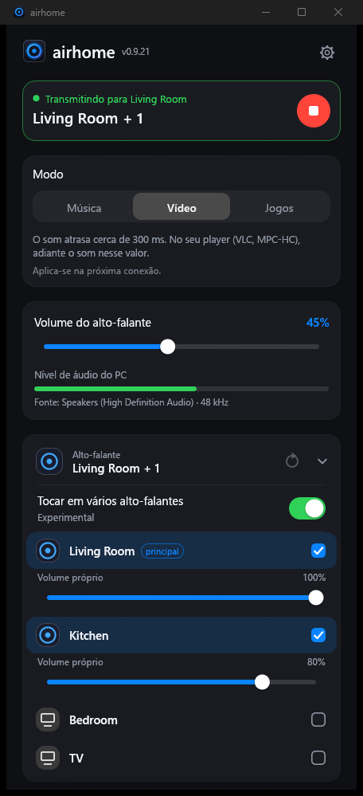
  &nbsp;&nbsp;
  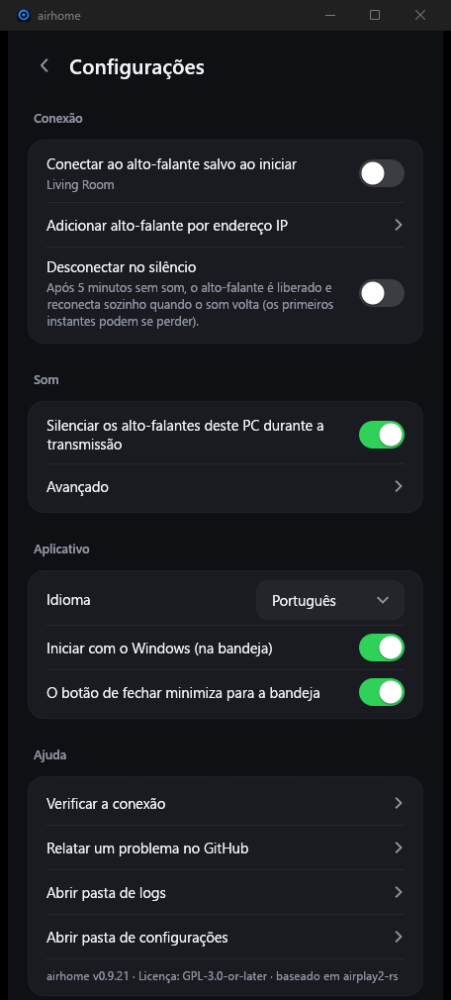
</p>

---
## Por que o airhome

O Windows não tem uma forma nativa de enviar o som para um HomePod. O airhome adiciona uma que simplesmente funciona:

- **Um clique, sem drivers.** Sem placa de som virtual, sem Bonjour, sem iTunes. Escolha um alto-falante e conecte.
- **Som só onde você quer.** Durante a transmissão, os alto-falantes do PC ficam mudos e são restaurados depois
  — mesmo que o programa seja fechado inesperadamente.
- **Vários alto-falantes ao mesmo tempo.** Toque em **+** ao lado de outros alto-falantes para tocar em todos em
  sincronia, cada um com seu próprio volume *(experimental)*.
- **Vive na bandeja.** Conecte, desconecte e mude o volume pelo menu da bandeja sem abrir a janela.
- **Permanece conectado.** Reconexão automática após uma falha de Wi-Fi, nova tentativa em início lento, botão para
  cancelar uma conexão demorada e notificação se algo falhar com a janela oculta.
- **Pequeno e privado.** Um único programa de 12 MB, sem nada extra para instalar. Sem conta, sem telemetria, sem
  verificação de atualizações, sem anúncios. Código aberto.
- **No seu idioma.** English, Русский, Español, Deutsch, Français, Português, 中文, 日本語.

## Recursos

| | |
|---|---|
| 🔊 **Áudio do sistema** | Captura tudo o que o Windows reproduz (WASAPI loopback) e envia como áudio AirPlay 2 criptografado |
| 🏠 **Compatível com HomePod** | Pareamento transitório do HomeKit, sincronização PTP precisa, funciona com o HomePod mini |
| 🎚 **Volume** | Volume geral e um nível separado para cada alto-falante; também pela bandeja |
| ⏱ **Atraso ajustável** | Buffer de 100 a 2000 ms: menor = mais imediato, maior = mais estável com Wi-Fi fraco |
| 🔌 **Adicionar por IP e porta** | Para redes em que a descoberta automática não funciona (VLANs, alguns roteadores) |
| 🔁 **Reconexão automática** | Restaura a transmissão após uma queda; a conexão pode ser cancelada a qualquer momento |
| 🔔 **Notificações** | Uma notificação do Windows se uma conexão falhar enquanto o airhome está na bandeja |
| 🚀 **Iniciar com o Windows** | Opcionalmente inicia oculto na bandeja e conecta ao seu alto-falante salvo |
| 🌍 **8 idiomas** | Escolhido automaticamente pelo Windows; altere em Configurações |

## Como funciona

```
  Som do Windows ──►  captura  ──►  codificação (ALAC) + criptografia  ──►  AirPlay 2  ──►  HomePod
  (o que você ouve)  (loopback)                                            (RTSP / RTP,
                                                                            relógio PTP)
```

O airhome escuta o som que o seu PC está reproduzindo, comprime sem perdas, criptografa e transmite ao alto-falante pela
rede local usando o protocolo AirPlay 2. Quando vários alto-falantes estão selecionados, eles compartilham um mesmo
relógio e tocam em sincronia. Para evitar som duplicado, a saída do próprio PC fica muda enquanto a transmissão durar.

## Instalação

1. Baixe **`airhome-setup-<versão>.exe`** na página [*Releases*](https://github.com/gmancode/airhome/releases/latest) e execute (não precisa de administrador).
2. Escolha o idioma e os atalhos desejados. A entrada no menu Iniciar é sempre criada.
3. Quando solicitado, permita o airhome no **Firewall do Windows** para redes privadas; caso contrário, não haverá som.

Requisitos: Windows 10 ou 11 (64 bits), um HomePod ou outro alto-falante AirPlay 2 na **mesma rede**, acesso AirPlay em
"Todos na mesma rede" e **sem senha AirPlay** no alto-falante.

## Início rápido

1. Abra o airhome. Seus alto-falantes aparecem na lista.
2. Toque em um alto-falante e pressione o botão redondo de **reproduzir**.
3. Feche a janela: o airhome continua tocando pela bandeja. Clique com o botão direito no ícone para conectar, desconectar e volume.

## Configurações

| Configuração | O que faz |
|---|---|
| Idioma | Idioma da interface |
| Iniciar com o Windows | Inicia oculto na bandeja ao entrar no sistema |
| Conectar ao alto-falante salvo ao iniciar | Conecta automaticamente; o nome do alto-falante aparece sob a chave |
| Silenciar os alto-falantes deste PC durante a transmissão | Evita som duplicado; restaurado automaticamente depois |
| O botão de fechar minimiza para a bandeja | Mantém o airhome em segundo plano |
| Adicionar alto-falante por endereço IP | Adiciona um alto-falante manualmente (IP e porta opcional, padrão 7000) |
| Buffer antes da reprodução | Controle de latência, 100–2000 ms (vale a partir da próxima conexão) |

## Dicas

- **O alto-falante não aparece?** Confirme que ele está na mesma rede e atualize. Se a sua rede bloqueia a descoberta,
  use *Adicionar alto-falante por endereço IP*.
- **Sem som?** Verifique se o Firewall do Windows permite o airhome em redes privadas e se o alto-falante não tem senha
  AirPlay. Filtros de rede (por exemplo, o driver de rede do AdGuard) podem bloquear a conexão.
- **O atraso importa (vídeo, jogos)?** Diminua o buffer. O AirPlay sempre adiciona algum atraso próprio, então para
  vídeo com sincronia labial um buffer pequeno é o melhor.
- **Falhas com Wi-Fi fraco?** Aumente o buffer.

## Estado

Desenvolvido e testado no Windows 11 com um HomePod mini. Espera-se que o Windows 10 funcione, mas não foi testado.
Tocar em vários alto-falantes é **experimental**. Ainda não existem versões nativas para Windows em ARM e Linux (a
versão x64 roda em ARM pela emulação do Windows, sem teste).

## O logotipo

<p align="center">
  
  &nbsp;
  
  &nbsp;
  
</p>

Um anel luminoso com um ponto no centro: o som de um alto-falante irradiando de uma única fonte. O anel acompanha o que o
airhome está fazendo na bandeja: **azul-violeta** em repouso, **âmbar** ao conectar e **verde** ao transmitir.

## Compilar a partir do código-fonte

Requisitos: Windows, Rust (toolchain MSVC). Este repositório contém tanto o aplicativo (`airhome/`) quanto a
biblioteca `airplay2-rs` modificada (`airplay2-rs/`), então não é preciso baixar mais nada.

```
cd airhome
cargo build --release
```

O executável é `target\release\airhome.exe`. Para criar o instalador, instale o
[Inno Setup 6](https://jrsoftware.org/isinfo.php) e execute `iscc /DAppVersion=<versão> installer\airhome.iss`.

## Licença

GPL-3.0-or-later — veja [`LICENSE`](LICENSE) e [`NOTICE.md`](airhome/NOTICE.md). Baseado em
[airplay2-rs](https://github.com/lmcgartland/airplay2-rs).

"AirPlay", "HomePod" e "Apple" são marcas da Apple Inc. O airhome é um projeto independente, sem afiliação nem
aprovação da Apple.

</details>

<details>
<summary><h2>🇨🇳 中文</h2></summary>

<p align="center">
  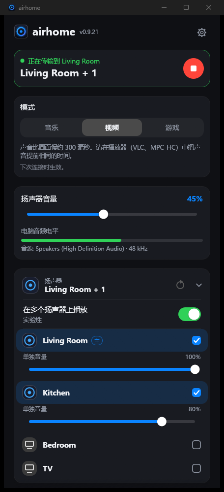
  &nbsp;&nbsp;
  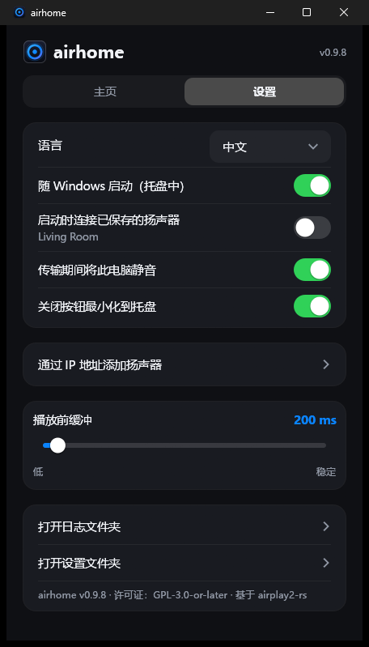
</p>

---
## 为什么选择 airhome

Windows 本身无法把声音发送到 HomePod。airhome 补上了这一环，而且开箱即用：

- **一键连接，无需驱动。** 不需要虚拟声卡、Bonjour 或 iTunes。选好扬声器，点击连接即可。
- **声音只出现在你想要的地方。** 串流期间自动静音电脑自带扬声器，结束后恢复——即使程序意外关闭也会恢复。
- **同时播放到多个扬声器。** 点击其他扬声器旁的 **+**，即可同步播放，每个扬声器可单独调音量 *（实验性）*。
- **常驻托盘。** 无需打开窗口，直接在托盘菜单里连接、断开和调节音量。
- **保持连接。** Wi-Fi 短暂中断后自动重连，启动缓慢时自动重试，连接太久可随时取消，窗口隐藏时出问题会弹出通知。
- **小巧且注重隐私。** 单个 12 MB 程序，无需额外安装运行库。无需账号，无遥测，不检查更新，没有广告。开源。
- **支持你的语言。** English、Русский、Español、Deutsch、Français、Português、中文、日本語。

## 功能

| | |
|---|---|
| 🔊 **系统音频** | 捕获 Windows 播放的所有声音（WASAPI loopback），以加密的 AirPlay 2 音频发送 |
| 🏠 **适配 HomePod** | HomeKit 临时配对、精确的 PTP 时钟同步，支持 HomePod mini |
| 🎚 **音量** | 总音量加每个扬声器的独立音量；也可在托盘中调节 |
| ⏱ **可调延迟** | 缓冲 100–2000 毫秒：越低越即时，越高在 Wi-Fi 较弱时越稳定 |
| 🔌 **按 IP 和端口添加** | 适用于无法自动发现设备的网络（VLAN、部分路由器） |
| 🔁 **自动重连** | 连接中断后自动恢复串流；连接过程可随时取消 |
| 🔔 **通知** | airhome 在托盘中时若连接失败，会弹出 Windows 通知 |
| 🚀 **开机启动** | 可选择在托盘中隐藏启动，并连接已保存的扬声器 |
| 🌍 **8 种语言** | 根据 Windows 自动选择；可在设置中更改 |

## 工作原理

```
  Windows 声音 ──►  捕获  ──►  编码 (ALAC) + 加密  ──►  AirPlay 2  ──►  HomePod
  （你听到的）    (loopback)                          (RTSP / RTP,
                                                       PTP 时钟)
```

airhome 监听电脑正在播放的声音，进行无损压缩和加密，再通过本地网络以 AirPlay 2 协议串流到扬声器。选择多个扬声器时，它们
共用同一个时钟，因此可以同步播放。为避免声音重叠，串流期间电脑自身的输出会被静音。

## 安装

1. 在 [*Releases*](https://github.com/gmancode/airhome/releases/latest) 页面下载 **`airhome-setup-<版本>.exe`** 并运行（无需管理员权限）。
2. 选择语言和需要的快捷方式。开始菜单项总是会创建。
3. 被询问时，请在 **Windows 防火墙** 中允许 airhome 访问专用网络，否则没有声音。

要求：Windows 10 或 11（64 位）、位于**同一网络**的 HomePod 或其他 AirPlay 2 扬声器，AirPlay 访问设为“同一网络中的所有人”，
且扬声器上**没有设置 AirPlay 密码**。

## 快速开始

1. 打开 airhome，扬声器会出现在列表中。
2. 点击一个扬声器，再按圆形的**播放**按钮。
3. 关闭窗口，airhome 会继续在托盘中播放。右键托盘图标可连接、断开和调节音量。

## 设置

| 设置 | 作用 |
|---|---|
| 语言 | 界面语言 |
| 随 Windows 启动 | 登录后在托盘中隐藏启动 |
| 启动时连接到已保存的扬声器 | 自动连接；开关下方会显示扬声器名称 |
| 串流时将此电脑静音 | 避免声音重叠；结束后自动恢复 |
| 关闭按钮最小化到托盘 | 让 airhome 在后台继续运行 |
| 通过 IP 地址添加扬声器 | 手动添加扬声器（IP 和可选端口，默认 7000） |
| 播放前缓冲 | 延迟滑块，100–2000 毫秒（下次连接时生效） |

## 小提示

- **列表里没有扬声器？** 确认它在同一网络中，然后点击刷新。如果网络阻止了设备发现，请使用“通过 IP 地址添加扬声器”。
- **没有声音？** 确认 Windows 防火墙允许 airhome 访问专用网络，且扬声器没有 AirPlay 密码。网络过滤软件（例如 AdGuard 的网络驱动）可能会阻止连接。
- **在意延迟（视频、游戏）？** 调低缓冲。AirPlay 本身总会带来一定延迟，对口型要求高的视频建议使用较小的缓冲。
- **Wi-Fi 较弱时断断续续？** 调高缓冲。

## 状态

在 Windows 11 上配合 HomePod mini 开发并测试。Windows 10 应该可以使用，但尚未测试。多扬声器播放为**实验性**功能。
目前还没有原生的 Windows on ARM 和 Linux 版本（x64 版本可通过 Windows 的模拟在 ARM 上运行，尚未测试）。

## 关于标志

<p align="center">
  
  &nbsp;
  
  &nbsp;
  
</p>

一个中心带圆点的发光圆环：扬声器的声音从同一个声源向外扩散。托盘中的圆环颜色反映 airhome 的状态：空闲时为**蓝紫色**，
连接时为**琥珀色**，串流时为**绿色**。

## 从源码构建

要求：Windows、Rust（MSVC 工具链）。本仓库同时包含应用程序（`airhome/`）和修改过的 `airplay2-rs` 库（`airplay2-rs/`），
无需再下载其他内容。

```
cd airhome
cargo build --release
```

可执行文件为 `target\release\airhome.exe`。要构建安装程序，请安装
[Inno Setup 6](https://jrsoftware.org/isinfo.php) 并运行 `iscc /DAppVersion=<版本> installer\airhome.iss`。

## 许可证

GPL-3.0-or-later，详见 [`LICENSE`](LICENSE) 和 [`NOTICE.md`](airhome/NOTICE.md)。基于
[airplay2-rs](https://github.com/lmcgartland/airplay2-rs)。

“AirPlay”“HomePod”和“Apple”是 Apple Inc. 的商标。airhome 是独立项目，与 Apple 无关联，也未获得 Apple 认可。

</details>

<details>
<summary><h2>🇯🇵 日本語</h2></summary>

<p align="center">
  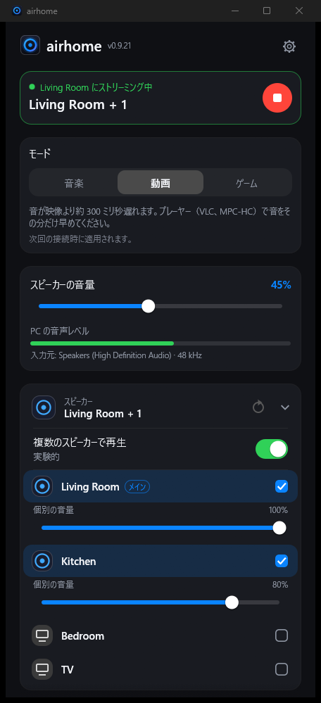
  &nbsp;&nbsp;
  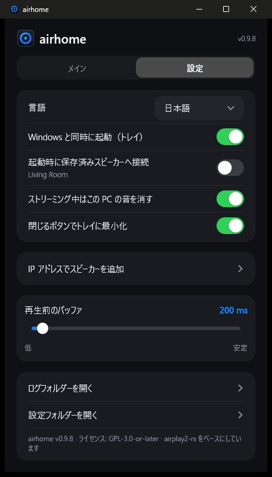
</p>

---
## airhome の特長

Windows には、音を HomePod に送る標準機能がありません。airhome は、それをすぐに使える形で追加します。

- **ワンクリック、ドライバ不要。** 仮想サウンドカードも Bonjour も iTunes も不要。スピーカーを選んで接続するだけです。
- **音は必要な場所だけに。** ストリーミング中は PC 本体のスピーカーを自動でミュートし、終了後に元へ戻します。
  プログラムが予期せず終了した場合でも復元されます。
- **複数のスピーカーで同時再生。** 他のスピーカーの横の **+** をタップすると同期して再生し、音量もそれぞれ調整できます *（試験的）*。
- **トレイに常駐。** ウィンドウを開かずに、トレイのメニューから接続・切断・音量調整ができます。
- **つながり続ける。** Wi-Fi が一瞬切れても自動で再接続し、起動が遅いときは再試行し、長引く接続はキャンセルでき、
  ウィンドウを隠しているときに問題が起きれば通知します。
- **小さくてプライバシーに配慮。** 12 MB の単体プログラムで、追加のランタイムは不要。アカウント、テレメトリ、
  更新確認、広告はありません。オープンソースです。
- **あなたの言語で。** English、Русский、Español、Deutsch、Français、Português、中文、日本語。

## 機能

| | |
|---|---|
| 🔊 **システム音声** | Windows が再生するすべての音を取り込み（WASAPI loopback）、暗号化した AirPlay 2 音声として送信 |
| 🏠 **HomePod 対応** | HomeKit の一時ペアリング、正確な PTP 時刻同期、HomePod mini で動作 |
| 🎚 **音量** | 全体の音量に加えて、スピーカーごとの音量。トレイからも操作可能 |
| ⏱ **遅延の調整** | バッファを 100〜2000 ms で設定：小さいほど即時性が高く、大きいほど弱い Wi-Fi で安定 |
| 🔌 **IP とポートで追加** | 自動検出が機能しないネットワーク（VLAN、一部のルーター）向け |
| 🔁 **自動再接続** | 接続が切れてもストリームを復旧。接続中はいつでもキャンセル可能 |
| 🔔 **通知** | airhome がトレイにある間に接続が失敗した場合、Windows の通知でお知らせ |
| 🚀 **Windows と同時に起動** | 必要に応じてトレイに隠れた状態で起動し、保存したスピーカーに接続 |
| 🌍 **8 言語** | Windows の設定から自動選択。設定で変更も可能 |

## しくみ

```
  Windows の音 ──►  取り込み  ──►  エンコード (ALAC) + 暗号化  ──►  AirPlay 2  ──►  HomePod
  （聞こえる音）   (loopback)                                      (RTSP / RTP,
                                                                    PTP クロック)
```

airhome は PC が再生している音を取り込み、可逆圧縮して暗号化し、ローカルネットワーク経由で AirPlay 2 プロトコルを使って
スピーカーへストリーミングします。複数のスピーカーを選ぶと、同じクロックを共有して同期再生します。音が二重にならない
よう、ストリーミング中は PC 自体の出力をミュートします。

## インストール

1. [*Releases*](https://github.com/gmancode/airhome/releases/latest) ページから **`airhome-setup-<バージョン>.exe`** をダウンロードして実行します（管理者権限は不要）。
2. 言語と作成するショートカットを選びます。スタートメニューの項目は常に作成されます。
3. 確認が表示されたら、**Windows ファイアウォール**でプライベートネットワークへの airhome を許可してください。許可しないと音が出ません。

動作要件：Windows 10 または 11（64 ビット）、**同じネットワーク**にある HomePod などの AirPlay 2 スピーカー、AirPlay のアクセスを
「同じネットワーク上のすべての人」に設定し、スピーカーに **AirPlay パスワードを設定しない**こと。

## クイックスタート

1. airhome を開くと、スピーカーが一覧に表示されます。
2. スピーカーをタップし、丸い**再生**ボタンを押します。
3. ウィンドウを閉じても、airhome はトレイで再生を続けます。トレイのアイコンを右クリックすると、接続・切断・音量を操作できます。

## 設定

| 設定 | 内容 |
|---|---|
| 言語 | 画面表示の言語 |
| Windows と同時に起動 | サインイン時にトレイに隠れた状態で起動 |
| 起動時に保存済みスピーカーへ接続 | 自動で接続。スイッチの下にスピーカー名を表示 |
| ストリーミング中はこの PC の音を消す | 音の二重化を防ぎ、終了後に自動で元へ戻す |
| 閉じるボタンでトレイに最小化 | airhome をバックグラウンドで動かし続ける |
| IP アドレスでスピーカーを追加 | スピーカーを手動で追加（IP と任意のポート、既定は 7000） |
| 再生前のバッファ | 遅延スライダー、100〜2000 ms（次回の接続から反映） |

## ヒント

- **スピーカーが一覧にない？** 同じネットワークにあるか確認して、更新を押してください。ネットワークが検出をブロックしている場合は
  「IP アドレスでスピーカーを追加」を使います。
- **音が出ない？** Windows ファイアウォールがプライベートネットワークで airhome を許可しているか、スピーカーに AirPlay パスワードが
  ないか確認してください。ネットワークフィルター（例：AdGuard のネットワークドライバ）が接続を妨げることがあります。
- **遅延が気になる（動画、ゲーム）？** バッファを小さくしてください。AirPlay には常にある程度の遅延があるため、口の動きと
  音を合わせたい動画では小さめのバッファが最適です。
- **弱い Wi-Fi で音が途切れる？** バッファを大きくしてください。

## 状況

Windows 11 と HomePod mini で開発・テストしています。Windows 10 でも動作する見込みですが、未テストです。複数スピーカーでの再生は
**試験的**な機能です。Windows on ARM と Linux のネイティブ版はまだありません（x64 版は Windows のエミュレーションで ARM 上でも動く
見込みですが、未テストです）。

## ロゴについて

<p align="center">
  
  &nbsp;
  
  &nbsp;
  
</p>

中心に点がある光るリング：ひとつの音源から広がるスピーカーの音を表しています。トレイのリングの色は airhome の状態を示します：
待機中は**青紫**、接続中は**アンバー**、ストリーミング中は**緑**です。

## ソースからビルド

必要なもの：Windows、Rust（MSVC ツールチェーン）。このリポジトリにはアプリ本体（`airhome/`）と修正済みの `airplay2-rs` ライブラリ
（`airplay2-rs/`）の両方が含まれているため、ほかにダウンロードするものはありません。

```
cd airhome
cargo build --release
```

実行ファイルは `target\release\airhome.exe` です。インストーラーを作るには
[Inno Setup 6](https://jrsoftware.org/isinfo.php) をインストールし、`iscc /DAppVersion=<バージョン> installer\airhome.iss` を実行します。

## ライセンス

GPL-3.0-or-later。[`LICENSE`](LICENSE) と [`NOTICE.md`](airhome/NOTICE.md) を参照してください。
[airplay2-rs](https://github.com/lmcgartland/airplay2-rs) をベースにしています。

「AirPlay」「HomePod」「Apple」は Apple Inc. の商標です。airhome は独立したプロジェクトであり、Apple との提携や Apple による承認はありません。

</details>
