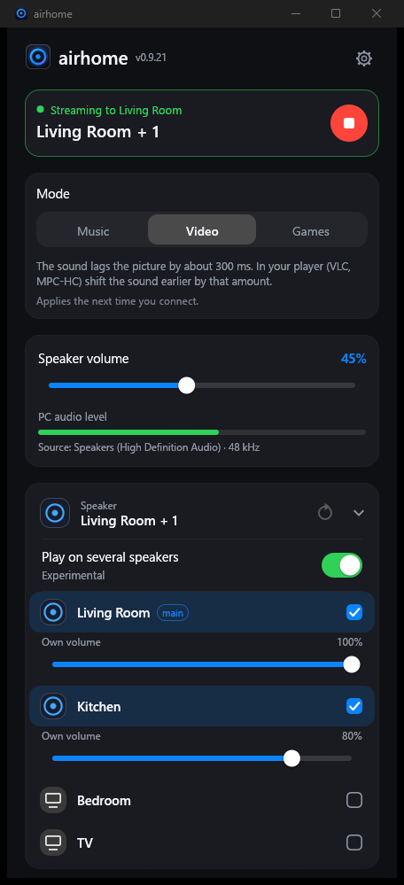
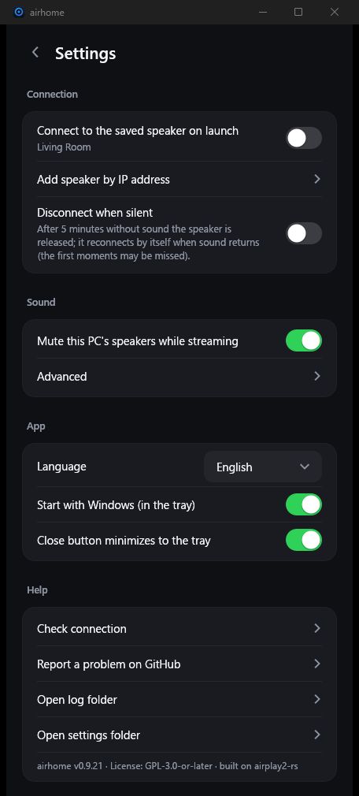

<p align="center">
  
</p>

<h1 align="center">airhome</h1>

<p align="center">
  <b>Play your Windows sound on a HomePod — in one click.</b><br>
  A small, free tray app that sends everything you hear on your PC to AirPlay 2 speakers.
</p>

<p align="center">
  
  
  
  
</p>

<p align="center">
  <b>English</b> ·
  <a href="README.ru.md">Русский</a> ·
  <a href="README.es.md">Español</a> ·
  <a href="README.de.md">Deutsch</a> ·
  <a href="README.fr.md">Français</a> ·
  <a href="README.pt.md">Português</a> ·
  <a href="README.zh.md">中文</a> ·
  <a href="README.ja.md">日本語</a>
</p>

<p align="center">
  
  &nbsp;&nbsp;
  
</p>

---

## Why airhome

Windows has no built-in way to send its sound to a HomePod. airhome adds one that just works:

- **One click, no drivers.** No virtual sound card, no Bonjour, no iTunes. Pick a speaker, press connect.
- **Sound only where you want it.** While streaming, your PC's own speakers are muted and restored afterwards
  — even if the program is closed unexpectedly.
- **Several speakers at once.** Turn on *Play on several speakers*, tick the speakers you want and they play in sync, each with its own volume *(experimental)*.
- **Lives in the tray.** Connect, disconnect and change the volume from the tray menu without opening the window.
- **Stays connected.** Automatic reconnect after a Wi-Fi hiccup, a retry on a slow start, a button to cancel a
  connection that takes too long, and a notification if something goes wrong while the window is hidden.
- **Small and private.** One 12 MB program with no extra runtime to install. No account, no telemetry, no
  update pings, no ads. Open source.
- **Speaks your language.** English, Русский, Español, Deutsch, Français, Português, 中文, 日本語.

## Features

| | |
|---|---|
| 🔊 **System audio** | Captures everything Windows plays (WASAPI loopback) and sends it as encrypted AirPlay 2 audio |
| 🏠 **HomePod friendly** | HomeKit transient pairing, accurate PTP timing, works with HomePod mini |
| 🎚 **Volume** | Master volume plus a separate level for every speaker; also controllable from the tray |
| 🎛 **Music / Video / Games** | One switch for how soon the speaker plays: Music is the steadiest, Video and Games cut the delay by more than half (measured with a microphone on a HomePod mini) |
| ⏱ **Adjustable buffer** | Under *Advanced*: 100 to 2000 ms, lower is more immediate, higher is steadier on weak Wi-Fi |
| 😴 **Disconnect when silent** | Optional: after 5 minutes without sound the speaker is released and reconnects by itself when sound returns |
| 🩺 **Check connection** | One button that looks for the usual causes of silence (network type, tools that block the connection, VPN adapters, busy ports) and says what to change |
| 🔌 **Add by IP and port** | For networks where automatic discovery does not work (VLANs, some routers) |
| 🔁 **Auto reconnect** | Brings the stream back after the connection drops; connecting can be cancelled at any time |
| 🔔 **Notifications** | A Windows notification if a connection fails while airhome is in the tray |
| 🚀 **Start with Windows** | Optionally starts hidden in the tray and connects to your saved speaker |
| 🌍 **8 languages** | Picked automatically from Windows; change it in Settings |

## How it works

```
  Windows sound ──►  capture  ──►  encode (ALAC) + encrypt  ──►  AirPlay 2  ──►  HomePod
  (what you hear)    (loopback)                                   (RTSP / RTP,
                                                                   PTP clock)
```

airhome listens to the sound your PC is playing, compresses it losslessly, encrypts it and streams it to the
speaker over your local network using the AirPlay 2 protocol. When several speakers are selected, they share one
clock so they play in sync. To avoid doubled sound, the PC's own output is muted while the stream runs.

## Install

1. Download **`airhome-setup-<version>.exe`** from the [*Releases*](https://github.com/gmancode/airhome/releases/latest) page and run it (no administrator rights needed).
2. Pick your language and the shortcuts you want. A Start menu entry is always created.
3. Allow airhome through **Windows Firewall** for private networks when asked — otherwise there is no sound.

Requirements: Windows 10 or 11 (64-bit), a HomePod or another AirPlay 2 speaker on the **same network**, AirPlay
access set to "Everyone on the same network" and **no AirPlay password** on the speaker.

## Quick start

1. Open airhome. Your speakers appear in the list.
2. Tap a speaker, then press the round **play** button.
3. Close the window — airhome keeps playing from the tray. Right-click the tray icon for connect / disconnect and volume.

## Settings

| Setting | What it does |
|---|---|
| Language | Interface language |
| Start with Windows | Starts hidden in the tray when you sign in |
| Connect to the saved speaker on launch | Connects automatically; the speaker's name is shown under the switch |
| Mute this PC's speakers while streaming | Prevents doubled sound; restored automatically afterwards |
| Close button minimizes to the tray | Keeps airhome running in the background |
| Add speaker by IP address | Adds a speaker manually (IP and optional port, default 7000) |
| Mode (Music / Video / Games) | How soon the speaker plays; Video and Games lower the delay (applies on the next connection) |
| Disconnect when silent | Releases the speaker after 5 minutes without sound and reconnects when sound returns |
| Check connection | Tests the network, ports, VPN adapters and sound device and can copy a report |
| Report a problem on GitHub | Opens the issue form; attach the log from *Open log folder* |
| Buffer before playback (under Advanced) | Latency slider, 100–2000 ms (applies on the next connection) |

## Tips

- **Speaker not in the list?** Check it is on the same network, then press refresh. If your network blocks
  discovery, use *Add speaker by IP address*.
- **No sound?** Make sure Windows Firewall allows airhome on private networks, and that the speaker has no AirPlay
  password. Network filters (for example AdGuard's network driver) can block the connection.
- **Delay matters (video, games)?** Choose **Video** or **Games** mode: the delay to the ear drops from about 700 ms to about 300 and 260 ms (measured with a 100 ms buffer on a HomePod mini). A little is left, so in a player such as VLC or MPC-HC shift the sound earlier by about that amount.
- **Choppy on weak Wi-Fi?** Raise the buffer.

## Status

Developed and tested on Windows 11 with a HomePod mini. Windows 10 is expected to work but has not been tested.
Playing on several speakers is **experimental**. Native Windows-on-ARM and Linux builds do not exist yet (the
x64 build runs on ARM with Windows' emulation, untested).

## The logo

<p align="center">
  
  &nbsp;
  
  &nbsp;
  
</p>

A glowing ring with a point at its centre — a speaker's sound radiating from a single source. The ring follows what
airhome is doing in the tray: **blue-violet** when idle, **amber** while connecting, **green** while streaming.

## Build from source

Requirements: Windows, Rust (MSVC toolchain). This repository contains both the application (`airhome/`) and the
modified `airplay2-rs` library (`airplay2-rs/`), so there is nothing else to download.

```
cd airhome
cargo build --release
```

The executable is `target\release\airhome.exe`. To build the installer, install
[Inno Setup 6](https://jrsoftware.org/isinfo.php) and run `iscc /DAppVersion=<version> installer\airhome.iss`.

## License

GPL-3.0-or-later — see [`LICENSE`](LICENSE) and [`NOTICE.md`](airhome/NOTICE.md). Built on
[airplay2-rs](https://github.com/lmcgartland/airplay2-rs).

"AirPlay", "HomePod" and "Apple" are trademarks of Apple Inc. airhome is an independent project and is not
affiliated with or endorsed by Apple.
