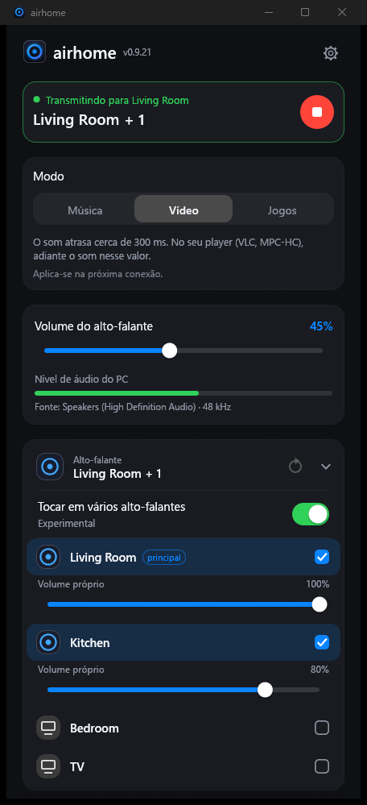
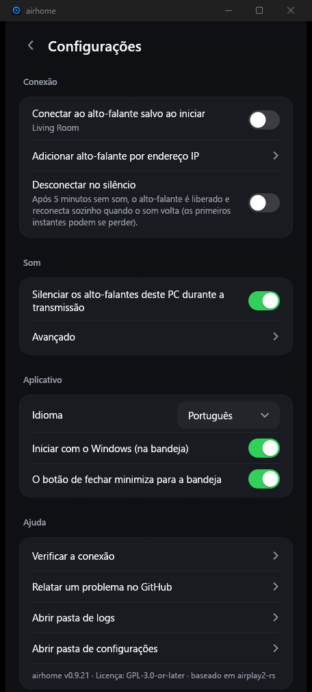

<p align="center">
  
</p>

<h1 align="center">airhome</h1>

<p align="center">
  <b>O som do Windows no seu HomePod, com um clique.</b><br>
  Um pequeno aplicativo gratuito da bandeja que envia tudo o que você ouve no PC para alto-falantes AirPlay 2.
</p>

<p align="center">
  
  
  
  
</p>

<p align="center">
  <a href="README.md">English</a> ·
  <a href="README.ru.md">Русский</a> ·
  <a href="README.es.md">Español</a> ·
  <a href="README.de.md">Deutsch</a> ·
  <a href="README.fr.md">Français</a> ·
  <b>Português</b> ·
  <a href="README.zh.md">中文</a> ·
  <a href="README.ja.md">日本語</a>
</p>

<p align="center">
  
  &nbsp;&nbsp;
  
</p>

---

## Por que o airhome

O Windows não tem uma forma nativa de enviar o som para um HomePod. O airhome adiciona uma que simplesmente funciona:

- **Um clique, sem drivers.** Sem placa de som virtual, sem Bonjour, sem iTunes. Escolha um alto-falante e conecte.
- **Som só onde você quer.** Durante a transmissão, os alto-falantes do PC ficam mudos e são restaurados depois
  — mesmo que o programa seja fechado inesperadamente.
- **Vários alto-falantes ao mesmo tempo.** Ative *Tocar em vários alto-falantes*, marque os que quiser e eles tocam em sincronia, cada um com seu próprio volume *(experimental)*.
- **Vive na bandeja.** Conecte, desconecte e mude o volume pelo menu da bandeja sem abrir a janela.
- **Permanece conectado.** Reconexão automática após uma falha de Wi-Fi, nova tentativa em início lento, botão para
  cancelar uma conexão demorada e notificação se algo falhar com a janela oculta.
- **Pequeno e privado.** Um único programa de 12 MB, sem nada extra para instalar. Sem conta, sem telemetria, sem
  verificação de atualizações, sem anúncios. Código aberto.
- **No seu idioma.** English, Русский, Español, Deutsch, Français, Português, 中文, 日本語.

## Recursos

| | |
|---|---|
| 🔊 **Áudio do sistema** | Captura tudo o que o Windows reproduz (WASAPI loopback) e envia como áudio AirPlay 2 criptografado |
| 🏠 **Compatível com HomePod** | Pareamento transitório do HomeKit, sincronização PTP precisa, funciona com o HomePod mini |
| 🎚 **Volume** | Volume geral e um nível separado para cada alto-falante; também pela bandeja |
| 🎛 **Música / Vídeo / Jogos** | Um botão para escolher quão rápido o alto-falante toca: Música é o mais estável, Vídeo e Jogos reduzem o atraso para menos da metade (medido com um microfone em um HomePod mini) |
| ⏱ **Buffer ajustável** | Em *Avançado*: de 100 a 2000 ms, menor = mais imediato, maior = mais estável com Wi-Fi fraco |
| 😴 **Desconectar no silêncio** | Opcional: após 5 minutos sem som, o alto-falante é liberado e reconecta sozinho quando o som volta |
| 🩺 **Verificar a conexão** | Um botão que procura as causas comuns do silêncio (tipo de rede, programas que bloqueiam a conexão, adaptadores VPN, portas ocupadas) e diz o que mudar |
| 🔌 **Adicionar por IP e porta** | Para redes em que a descoberta automática não funciona (VLANs, alguns roteadores) |
| 🔁 **Reconexão automática** | Restaura a transmissão após uma queda; a conexão pode ser cancelada a qualquer momento |
| 🔔 **Notificações** | Uma notificação do Windows se uma conexão falhar enquanto o airhome está na bandeja |
| 🚀 **Iniciar com o Windows** | Opcionalmente inicia oculto na bandeja e conecta ao seu alto-falante salvo |
| 🌍 **8 idiomas** | Escolhido automaticamente pelo Windows; altere em Configurações |

## Como funciona

```
  Som do Windows ──►  captura  ──►  codificação (ALAC) + criptografia  ──►  AirPlay 2  ──►  HomePod
  (o que você ouve)  (loopback)                                            (RTSP / RTP,
                                                                            relógio PTP)
```

O airhome escuta o som que o seu PC está reproduzindo, comprime sem perdas, criptografa e transmite ao alto-falante pela
rede local usando o protocolo AirPlay 2. Quando vários alto-falantes estão selecionados, eles compartilham um mesmo
relógio e tocam em sincronia. Para evitar som duplicado, a saída do próprio PC fica muda enquanto a transmissão durar.

## Instalação

1. Baixe **`airhome-setup-<versão>.exe`** na página [*Releases*](https://github.com/gmancode/airhome/releases/latest) e execute (não precisa de administrador).
2. Escolha o idioma e os atalhos desejados. A entrada no menu Iniciar é sempre criada.
3. Quando solicitado, permita o airhome no **Firewall do Windows** para redes privadas; caso contrário, não haverá som.

Requisitos: Windows 10 ou 11 (64 bits), um HomePod ou outro alto-falante AirPlay 2 na **mesma rede**, acesso AirPlay em
"Todos na mesma rede" e **sem senha AirPlay** no alto-falante.

## Início rápido

1. Abra o airhome. Seus alto-falantes aparecem na lista.
2. Toque em um alto-falante e pressione o botão redondo de **reproduzir**.
3. Feche a janela: o airhome continua tocando pela bandeja. Clique com o botão direito no ícone para conectar, desconectar e volume.

## Configurações

| Configuração | O que faz |
|---|---|
| Idioma | Idioma da interface |
| Iniciar com o Windows | Inicia oculto na bandeja ao entrar no sistema |
| Conectar ao alto-falante salvo ao iniciar | Conecta automaticamente; o nome do alto-falante aparece sob a chave |
| Silenciar os alto-falantes deste PC durante a transmissão | Evita som duplicado; restaurado automaticamente depois |
| O botão de fechar minimiza para a bandeja | Mantém o airhome em segundo plano |
| Adicionar alto-falante por endereço IP | Adiciona um alto-falante manualmente (IP e porta opcional, padrão 7000) |
| Modo (Música / Vídeo / Jogos) | Quão rápido o alto-falante toca; Vídeo e Jogos reduzem o atraso (vale a partir da próxima conexão) |
| Desconectar no silêncio | Libera o alto-falante após 5 minutos sem som e reconecta quando o som volta |
| Verificar a conexão | Testa a rede, as portas, os adaptadores VPN e a saída de som, e pode copiar um relatório |
| Relatar um problema no GitHub | Abre o formulário; anexe o log de *Abrir pasta de logs* |
| Buffer antes da reprodução (em Avançado) | Controle de latência, 100–2000 ms (vale a partir da próxima conexão) |

## Dicas

- **O alto-falante não aparece?** Confirme que ele está na mesma rede e atualize. Se a sua rede bloqueia a descoberta,
  use *Adicionar alto-falante por endereço IP*.
- **Sem som?** Verifique se o Firewall do Windows permite o airhome em redes privadas e se o alto-falante não tem senha
  AirPlay. Filtros de rede (por exemplo, o driver de rede do AdGuard) podem bloquear a conexão.
- **O atraso importa (vídeo, jogos)?** Escolha o modo **Vídeo** ou **Jogos**: o atraso até o ouvido cai de cerca de 700 ms para cerca de 300 e 260 ms (medido com buffer de 100 ms em um HomePod mini). Sobra um pouco, então em um player como VLC ou MPC-HC adiante o som aproximadamente nessa quantidade.
- **Falhas com Wi-Fi fraco?** Aumente o buffer.

## Estado

Desenvolvido e testado no Windows 11 com um HomePod mini. Espera-se que o Windows 10 funcione, mas não foi testado.
Tocar em vários alto-falantes é **experimental**. Ainda não existem versões nativas para Windows em ARM e Linux (a
versão x64 roda em ARM pela emulação do Windows, sem teste).

## O logotipo

<p align="center">
  
  &nbsp;
  
  &nbsp;
  
</p>

Um anel luminoso com um ponto no centro: o som de um alto-falante irradiando de uma única fonte. O anel acompanha o que o
airhome está fazendo na bandeja: **azul-violeta** em repouso, **âmbar** ao conectar e **verde** ao transmitir.

## Compilar a partir do código-fonte

Requisitos: Windows, Rust (toolchain MSVC). Este repositório contém tanto o aplicativo (`airhome/`) quanto a
biblioteca `airplay2-rs` modificada (`airplay2-rs/`), então não é preciso baixar mais nada.

```
cd airhome
cargo build --release
```

O executável é `target\release\airhome.exe`. Para criar o instalador, instale o
[Inno Setup 6](https://jrsoftware.org/isinfo.php) e execute `iscc /DAppVersion=<versão> installer\airhome.iss`.

## Licença

GPL-3.0-or-later — veja [`LICENSE`](LICENSE) e [`NOTICE.md`](airhome/NOTICE.md). Baseado em
[airplay2-rs](https://github.com/lmcgartland/airplay2-rs).

"AirPlay", "HomePod" e "Apple" são marcas da Apple Inc. O airhome é um projeto independente, sem afiliação nem
aprovação da Apple.
