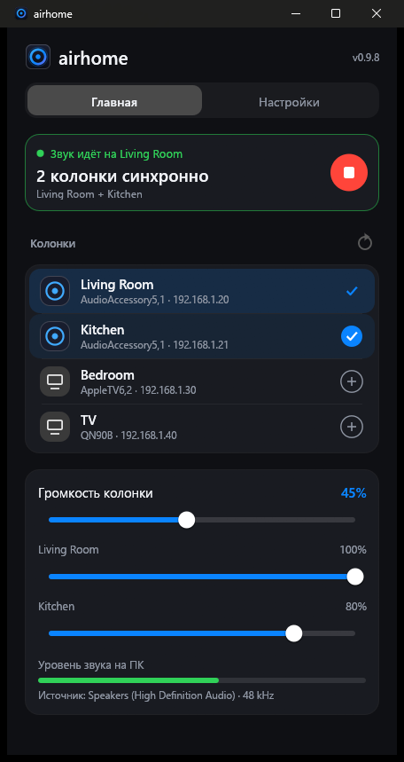
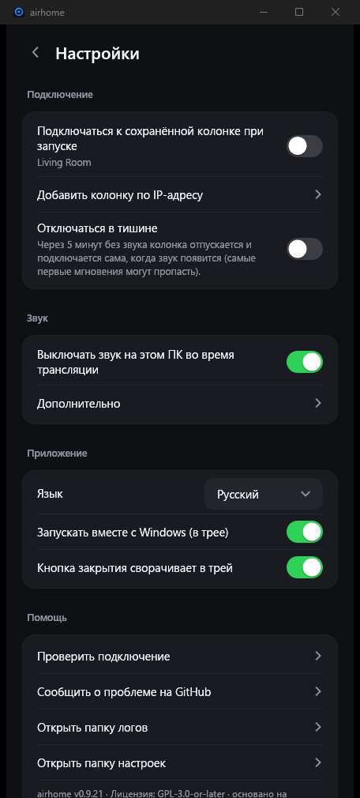

<p align="center">
  
</p>

<h1 align="center">airhome</h1>

<p align="center">
  <b>Звук Windows на HomePod — в один клик.</b><br>
  Небольшая бесплатная программа в трее: отправляет всё, что вы слышите на компьютере, на колонки AirPlay 2.
</p>

<p align="center">
  
  
  
  
</p>

<p align="center">
  <a href="README.md">English</a> ·
  <b>Русский</b> ·
  <a href="README.es.md">Español</a> ·
  <a href="README.de.md">Deutsch</a> ·
  <a href="README.fr.md">Français</a> ·
  <a href="README.pt.md">Português</a> ·
  <a href="README.zh.md">中文</a> ·
  <a href="README.ja.md">日本語</a>
</p>

<p align="center">
  
  &nbsp;&nbsp;
  
</p>

---

## Почему airhome

В Windows нет встроенного способа отправить звук на HomePod. airhome добавляет его, и он просто работает:

- **Один клик, без драйверов.** Никаких виртуальных звуковых карт, Bonjour и iTunes. Выберите колонку и нажмите «Подключиться».
- **Звук только там, где нужно.** Пока идёт трансляция, колонки компьютера выключены, а потом звук возвращается
  — даже если программа закрылась неожиданно.
- **Несколько колонок сразу.** Нажмите **+** у других колонок, и они заиграют синхронно, у каждой своя
  громкость *(экспериментально)*.
- **Живёт в трее.** Подключение, отключение и громкость доступны из меню в трее, окно открывать не нужно.
- **Не теряет связь.** Автоматическое переподключение после сбоя Wi-Fi, повтор при медленном старте, кнопка отмены
  слишком долгого подключения и уведомление, если что-то пошло не так, пока окно спрятано.
- **Маленькая и приватная.** Одна программа на 12 МБ, ничего дополнительно ставить не нужно. Без аккаунта,
  без телеметрии, без проверок обновлений, без рекламы. Открытый исходный код.
- **На вашем языке.** English, Русский, Español, Deutsch, Français, Português, 中文, 日本語.

## Возможности

| | |
|---|---|
| 🔊 **Звук системы** | Перехватывает всё, что играет Windows (WASAPI loopback), и отправляет зашифрованным потоком AirPlay 2 |
| 🏠 **Дружит с HomePod** | Транзитное сопряжение HomeKit, точная синхронизация PTP, работает с HomePod mini |
| 🎚 **Громкость** | Общая громкость и отдельный уровень каждой колонки; управляется и из трея |
| ⏱ **Настраиваемая задержка** | Буфер от 100 до 2000 мс: меньше — отклик быстрее, больше — стабильнее на слабом Wi-Fi |
| 🔌 **Добавление по IP и порту** | Для сетей, где автоматический поиск не работает (VLAN, некоторые роутеры) |
| 🔁 **Автопереподключение** | Возвращает поток после обрыва связи; подключение можно отменить в любой момент |
| 🔔 **Уведомления** | Уведомление Windows, если подключение не удалось, пока airhome в трее |
| 🚀 **Запуск с Windows** | При желании стартует скрытно в трее и подключается к сохранённой колонке |
| 🌍 **8 языков** | Определяется автоматически по Windows; меняется в настройках |

## Как это работает

```
  Звук Windows ──►  захват  ──►  кодирование (ALAC) + шифрование  ──►  AirPlay 2  ──►  HomePod
  (то, что вы слышите) (loopback)                                      (RTSP / RTP,
                                                                        часы PTP)
```

airhome слушает звук, который играет ваш компьютер, сжимает его без потерь, шифрует и отправляет на колонку по
локальной сети по протоколу AirPlay 2. Если выбрано несколько колонок, у них общие часы, поэтому они играют
синхронно. Чтобы звук не удваивался, собственный вывод компьютера на время трансляции отключается.

## Установка

1. Скачайте **`airhome-setup-<версия>.exe`** на странице [*Releases*](https://github.com/gmancode/airhome/releases/latest) и запустите (права администратора не нужны).
2. Выберите язык и нужные ярлыки. Запись в меню «Пуск» создаётся всегда.
3. Когда спросит **брандмауэр Windows**, разрешите airhome частные сети, иначе звука не будет.

Требования: Windows 10 или 11 (64-бит), HomePod или другая колонка AirPlay 2 в **той же сети**, в доступе AirPlay
выбрано «Все в той же сети» и на колонке **нет пароля AirPlay**.

## Быстрый старт

1. Откройте airhome. В списке появятся ваши колонки.
2. Нажмите колонку, затем круглую кнопку **play**.
3. Закройте окно — airhome продолжит играть из трея. Правый клик по значку открывает меню: подключение, отключение, громкость.

## Настройки

| Настройка | Что делает |
|---|---|
| Язык | Язык интерфейса |
| Запускать вместе с Windows | Стартует скрытно в трее при входе в систему |
| Подключаться к сохранённой колонке при запуске | Подключается автоматически; имя колонки показано под переключателем |
| Выключать звук на этом ПК во время трансляции | Не даёт звуку удваиваться; потом включается обратно сам |
| Кнопка закрытия сворачивает в трей | Программа продолжает работать в фоне |
| Добавить колонку по IP-адресу | Добавляет колонку вручную (IP и необязательный порт, по умолчанию 7000) |
| Буфер перед воспроизведением | Ползунок задержки, 100–2000 мс (применяется при следующем подключении) |

## Советы

- **Колонки нет в списке?** Проверьте, что она в той же сети, и нажмите «Обновить». Если сеть блокирует поиск,
  воспользуйтесь «Добавить колонку по IP-адресу».
- **Нет звука?** Убедитесь, что брандмауэр Windows разрешает airhome частные сети и что на колонке нет пароля
  AirPlay. Сетевые фильтры (например, сетевой драйвер AdGuard) могут блокировать подключение.
- **Важна задержка (видео, игры)?** Уменьшите буфер. AirPlay всегда добавляет свою задержку, поэтому для видео, где
  важна синхронизация с картинкой, лучше маленький буфер.
- **Прерывается на слабом Wi-Fi?** Увеличьте буфер.

## Статус

Разработана и проверена на Windows 11 с HomePod mini. Windows 10 должна работать, но не проверялась. Игра на нескольких
колонках **экспериментальная**. Родных сборок для Windows на ARM и Linux пока нет (сборка x64 запускается на ARM
через эмуляцию Windows, не проверено).

## Логотип

<p align="center">
  
  &nbsp;
  
  &nbsp;
  
</p>

Светящееся кольцо с точкой в центре: звук колонки, расходящийся из одного источника. Кольцо в трее показывает, что
делает airhome: **сине-фиолетовое**, когда ничего не идёт, **янтарное** при подключении, **зелёное** во время трансляции.

## Сборка из исходников

Нужны: Windows, Rust (набор инструментов MSVC). В этом репозитории лежат и приложение (`airhome/`), и изменённая
библиотека `airplay2-rs` (`airplay2-rs/`), так что ничего больше скачивать не нужно.

```
cd airhome
cargo build --release
```

Исполняемый файл: `target\release\airhome.exe`. Чтобы собрать установщик, установите
[Inno Setup 6](https://jrsoftware.org/isinfo.php) и выполните `iscc /DAppVersion=<версия> installer\airhome.iss`.

## Лицензия

GPL-3.0-or-later — см. [`LICENSE`](LICENSE) и [`NOTICE.md`](airhome/NOTICE.md). Основано на
[airplay2-rs](https://github.com/lmcgartland/airplay2-rs).

«AirPlay», «HomePod» и «Apple» — товарные знаки Apple Inc. airhome — независимый проект, не связан с Apple и не
одобрен ею.
