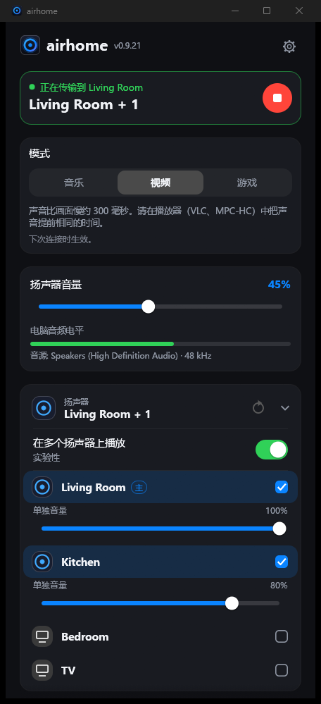
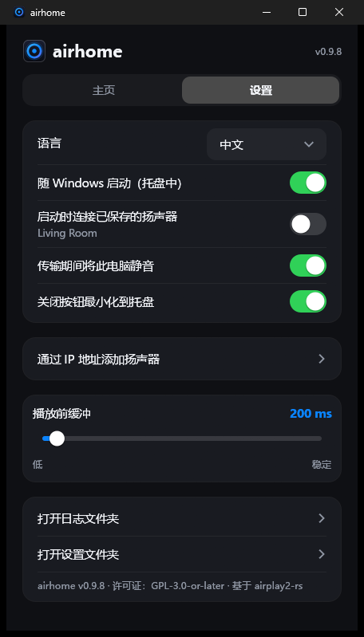

<p align="center">
  
</p>

<h1 align="center">airhome</h1>

<p align="center">
  <b>一键把 Windows 的声音送到 HomePod。</b><br>
  一款小巧免费的托盘应用，把电脑上听到的一切发送到 AirPlay 2 扬声器。
</p>

<p align="center">
  
  
  
  
</p>

<p align="center">
  <a href="README.md">English</a> ·
  <a href="README.ru.md">Русский</a> ·
  <a href="README.es.md">Español</a> ·
  <a href="README.de.md">Deutsch</a> ·
  <a href="README.fr.md">Français</a> ·
  <a href="README.pt.md">Português</a> ·
  <b>中文</b> ·
  <a href="README.ja.md">日本語</a>
</p>

<p align="center">
  
  &nbsp;&nbsp;
  
</p>

---

## 为什么选择 airhome

Windows 本身无法把声音发送到 HomePod。airhome 补上了这一环，而且开箱即用：

- **一键连接，无需驱动。** 不需要虚拟声卡、Bonjour 或 iTunes。选好扬声器，点击连接即可。
- **声音只出现在你想要的地方。** 串流期间自动静音电脑自带扬声器，结束后恢复——即使程序意外关闭也会恢复。
- **同时播放到多个扬声器。** 点击其他扬声器旁的 **+**，即可同步播放，每个扬声器可单独调音量 *（实验性）*。
- **常驻托盘。** 无需打开窗口，直接在托盘菜单里连接、断开和调节音量。
- **保持连接。** Wi-Fi 短暂中断后自动重连，启动缓慢时自动重试，连接太久可随时取消，窗口隐藏时出问题会弹出通知。
- **小巧且注重隐私。** 单个 12 MB 程序，无需额外安装运行库。无需账号，无遥测，不检查更新，没有广告。开源。
- **支持你的语言。** English、Русский、Español、Deutsch、Français、Português、中文、日本語。

## 功能

| | |
|---|---|
| 🔊 **系统音频** | 捕获 Windows 播放的所有声音（WASAPI loopback），以加密的 AirPlay 2 音频发送 |
| 🏠 **适配 HomePod** | HomeKit 临时配对、精确的 PTP 时钟同步，支持 HomePod mini |
| 🎚 **音量** | 总音量加每个扬声器的独立音量；也可在托盘中调节 |
| ⏱ **可调延迟** | 缓冲 100–2000 毫秒：越低越即时，越高在 Wi-Fi 较弱时越稳定 |
| 🔌 **按 IP 和端口添加** | 适用于无法自动发现设备的网络（VLAN、部分路由器） |
| 🔁 **自动重连** | 连接中断后自动恢复串流；连接过程可随时取消 |
| 🔔 **通知** | airhome 在托盘中时若连接失败，会弹出 Windows 通知 |
| 🚀 **开机启动** | 可选择在托盘中隐藏启动，并连接已保存的扬声器 |
| 🌍 **8 种语言** | 根据 Windows 自动选择；可在设置中更改 |

## 工作原理

```
  Windows 声音 ──►  捕获  ──►  编码 (ALAC) + 加密  ──►  AirPlay 2  ──►  HomePod
  （你听到的）    (loopback)                          (RTSP / RTP,
                                                       PTP 时钟)
```

airhome 监听电脑正在播放的声音，进行无损压缩和加密，再通过本地网络以 AirPlay 2 协议串流到扬声器。选择多个扬声器时，它们
共用同一个时钟，因此可以同步播放。为避免声音重叠，串流期间电脑自身的输出会被静音。

## 安装

1. 在 [*Releases*](https://github.com/gmancode/airhome/releases/latest) 页面下载 **`airhome-setup-<版本>.exe`** 并运行（无需管理员权限）。
2. 选择语言和需要的快捷方式。开始菜单项总是会创建。
3. 被询问时，请在 **Windows 防火墙** 中允许 airhome 访问专用网络，否则没有声音。

要求：Windows 10 或 11（64 位）、位于**同一网络**的 HomePod 或其他 AirPlay 2 扬声器，AirPlay 访问设为“同一网络中的所有人”，
且扬声器上**没有设置 AirPlay 密码**。

## 快速开始

1. 打开 airhome，扬声器会出现在列表中。
2. 点击一个扬声器，再按圆形的**播放**按钮。
3. 关闭窗口，airhome 会继续在托盘中播放。右键托盘图标可连接、断开和调节音量。

## 设置

| 设置 | 作用 |
|---|---|
| 语言 | 界面语言 |
| 随 Windows 启动 | 登录后在托盘中隐藏启动 |
| 启动时连接到已保存的扬声器 | 自动连接；开关下方会显示扬声器名称 |
| 串流时将此电脑静音 | 避免声音重叠；结束后自动恢复 |
| 关闭按钮最小化到托盘 | 让 airhome 在后台继续运行 |
| 通过 IP 地址添加扬声器 | 手动添加扬声器（IP 和可选端口，默认 7000） |
| 播放前缓冲 | 延迟滑块，100–2000 毫秒（下次连接时生效） |

## 小提示

- **列表里没有扬声器？** 确认它在同一网络中，然后点击刷新。如果网络阻止了设备发现，请使用“通过 IP 地址添加扬声器”。
- **没有声音？** 确认 Windows 防火墙允许 airhome 访问专用网络，且扬声器没有 AirPlay 密码。网络过滤软件（例如 AdGuard 的网络驱动）可能会阻止连接。
- **在意延迟（视频、游戏）？** 调低缓冲。AirPlay 本身总会带来一定延迟，对口型要求高的视频建议使用较小的缓冲。
- **Wi-Fi 较弱时断断续续？** 调高缓冲。

## 状态

在 Windows 11 上配合 HomePod mini 开发并测试。Windows 10 应该可以使用，但尚未测试。多扬声器播放为**实验性**功能。
目前还没有原生的 Windows on ARM 和 Linux 版本（x64 版本可通过 Windows 的模拟在 ARM 上运行，尚未测试）。

## 关于标志

<p align="center">
  
  &nbsp;
  
  &nbsp;
  
</p>

一个中心带圆点的发光圆环：扬声器的声音从同一个声源向外扩散。托盘中的圆环颜色反映 airhome 的状态：空闲时为**蓝紫色**，
连接时为**琥珀色**，串流时为**绿色**。

## 从源码构建

要求：Windows、Rust（MSVC 工具链）。本仓库同时包含应用程序（`airhome/`）和修改过的 `airplay2-rs` 库（`airplay2-rs/`），
无需再下载其他内容。

```
cd airhome
cargo build --release
```

可执行文件为 `target\release\airhome.exe`。要构建安装程序，请安装
[Inno Setup 6](https://jrsoftware.org/isinfo.php) 并运行 `iscc /DAppVersion=<版本> installer\airhome.iss`。

## 许可证

GPL-3.0-or-later，详见 [`LICENSE`](LICENSE) 和 [`NOTICE.md`](airhome/NOTICE.md)。基于
[airplay2-rs](https://github.com/lmcgartland/airplay2-rs)。

“AirPlay”“HomePod”和“Apple”是 Apple Inc. 的商标。airhome 是独立项目，与 Apple 无关联，也未获得 Apple 认可。
