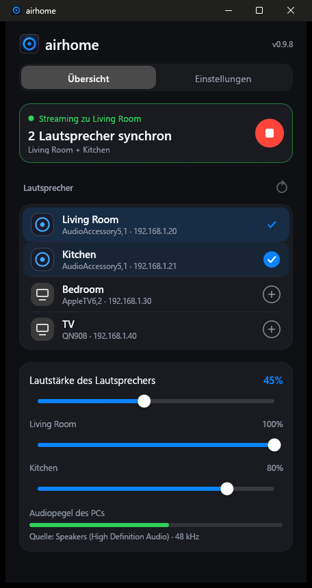
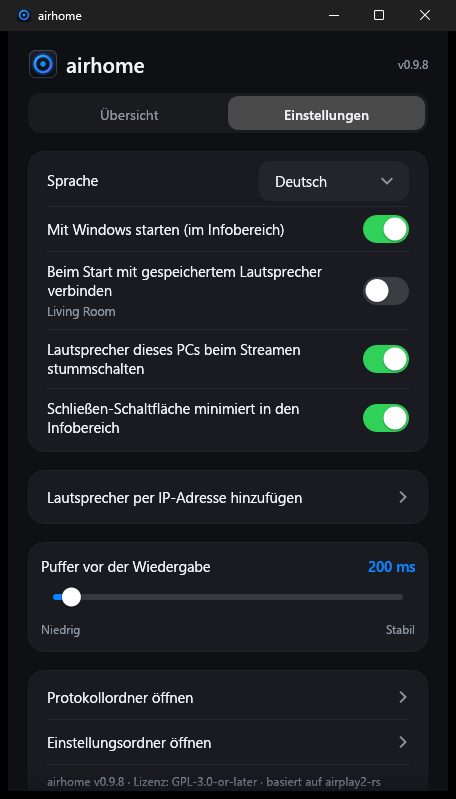

<p align="center">
  
</p>

<h1 align="center">airhome</h1>

<p align="center">
  <b>Windows-Ton auf dem HomePod – mit einem Klick.</b><br>
  Eine kleine, kostenlose Tray-App, die alles, was du am PC hörst, an AirPlay-2-Lautsprecher sendet.
</p>

<p align="center">
  
  
  
  
</p>

<p align="center">
  <a href="README.md">English</a> ·
  <a href="README.ru.md">Русский</a> ·
  <a href="README.es.md">Español</a> ·
  <b>Deutsch</b> ·
  <a href="README.fr.md">Français</a> ·
  <a href="README.pt.md">Português</a> ·
  <a href="README.zh.md">中文</a> ·
  <a href="README.ja.md">日本語</a>
</p>

<p align="center">
  
  &nbsp;&nbsp;
  
</p>

---

## Warum airhome

Windows kann seinen Ton nicht von Haus aus an einen HomePod senden. airhome ergänzt genau das – und es funktioniert einfach:

- **Ein Klick, keine Treiber.** Keine virtuelle Soundkarte, kein Bonjour, kein iTunes. Lautsprecher wählen, verbinden.
- **Ton nur dort, wo du ihn willst.** Beim Streamen werden die PC-Lautsprecher stummgeschaltet und danach wiederhergestellt
  – auch wenn das Programm unerwartet beendet wird.
- **Mehrere Lautsprecher gleichzeitig.** Tippe bei weiteren Lautsprechern auf **+**, um alle synchron abzuspielen, jeder
  mit eigener Lautstärke *(experimentell)*.
- **Lebt im Tray.** Verbinden, trennen und Lautstärke ändern direkt im Tray-Menü, ohne das Fenster zu öffnen.
- **Bleibt verbunden.** Automatische Wiederverbindung nach einem WLAN-Aussetzer, ein erneuter Versuch bei langsamem Start,
  ein Knopf zum Abbrechen einer zu langen Verbindung und eine Benachrichtigung, wenn bei verstecktem Fenster etwas schiefgeht.
- **Klein und privat.** Ein einziges 12-MB-Programm ohne zusätzliche Laufzeitumgebung. Kein Konto, keine Telemetrie,
  keine Update-Abfragen, keine Werbung. Open Source.
- **In deiner Sprache.** English, Русский, Español, Deutsch, Français, Português, 中文, 日本語.

## Funktionen

| | |
|---|---|
| 🔊 **Systemton** | Erfasst alles, was Windows abspielt (WASAPI-Loopback), und sendet es als verschlüsseltes AirPlay-2-Audio |
| 🏠 **HomePod-tauglich** | HomeKit-Transient-Pairing, präzise PTP-Zeitsynchronisation, funktioniert mit HomePod mini |
| 🎚 **Lautstärke** | Gesamtlautstärke plus eigener Pegel für jeden Lautsprecher; auch über das Tray bedienbar |
| ⏱ **Einstellbare Verzögerung** | Puffer von 100 bis 2000 ms: niedriger = direkter, höher = stabiler bei schwachem WLAN |
| 🔌 **Hinzufügen per IP und Port** | Für Netzwerke, in denen die automatische Suche nicht funktioniert (VLANs, manche Router) |
| 🔁 **Automatische Wiederverbindung** | Holt den Stream nach einem Abbruch zurück; Verbinden lässt sich jederzeit abbrechen |
| 🔔 **Benachrichtigungen** | Eine Windows-Benachrichtigung, wenn eine Verbindung scheitert, während airhome im Tray läuft |
| 🚀 **Start mit Windows** | Startet auf Wunsch versteckt im Tray und verbindet sich mit deinem gespeicherten Lautsprecher |
| 🌍 **8 Sprachen** | Wird automatisch aus Windows übernommen; in den Einstellungen änderbar |

## So funktioniert es

```
  Windows-Ton ──►  Erfassung  ──►  Kodierung (ALAC) + Verschlüsselung  ──►  AirPlay 2  ──►  HomePod
  (was du hörst)   (Loopback)                                              (RTSP / RTP,
                                                                            PTP-Takt)
```

airhome hört den Ton mit, den dein PC abspielt, komprimiert ihn verlustfrei, verschlüsselt ihn und streamt ihn über
dein lokales Netzwerk per AirPlay-2-Protokoll an den Lautsprecher. Sind mehrere Lautsprecher gewählt, teilen sie
sich einen Takt und spielen synchron. Damit der Ton nicht doppelt erklingt, wird die eigene Ausgabe des PCs während
des Streams stummgeschaltet.

## Installation

1. Lade **`airhome-setup-<Version>.exe`** von der Seite *Releases* herunter und starte sie (keine Administratorrechte nötig).
2. Wähle Sprache und gewünschte Verknüpfungen. Ein Startmenü-Eintrag wird immer angelegt.
3. Erlaube airhome in der **Windows-Firewall** für private Netzwerke, wenn danach gefragt wird – sonst gibt es keinen Ton.

Voraussetzungen: Windows 10 oder 11 (64 Bit), ein HomePod oder anderer AirPlay-2-Lautsprecher im **selben Netzwerk**,
AirPlay-Zugriff auf „Alle im selben Netzwerk“ und **kein AirPlay-Passwort** am Lautsprecher.

## Schnellstart

1. Öffne airhome. Deine Lautsprecher erscheinen in der Liste.
2. Tippe einen Lautsprecher an und drücke den runden **Play**-Knopf.
3. Schließe das Fenster – airhome spielt im Tray weiter. Rechtsklick auf das Tray-Symbol: Verbinden, Trennen, Lautstärke.

## Einstellungen

| Einstellung | Wirkung |
|---|---|
| Sprache | Sprache der Oberfläche |
| Mit Windows starten | Startet beim Anmelden versteckt im Tray |
| Beim Start mit gespeichertem Lautsprecher verbinden | Verbindet automatisch; der Name steht unter dem Schalter |
| Lautsprecher dieses PCs beim Streamen stummschalten | Verhindert doppelten Ton; wird danach automatisch wiederhergestellt |
| Schließen-Schaltfläche minimiert in den Infobereich | Hält airhome im Hintergrund am Laufen |
| Lautsprecher per IP-Adresse hinzufügen | Fügt einen Lautsprecher manuell hinzu (IP und optionaler Port, Standard 7000) |
| Puffer vor der Wiedergabe | Latenz-Regler, 100–2000 ms (gilt ab der nächsten Verbindung) |

## Tipps

- **Lautsprecher fehlt in der Liste?** Prüfe, ob er im selben Netzwerk ist, und drücke Aktualisieren. Blockiert dein
  Netzwerk die Suche, nutze *Lautsprecher per IP-Adresse hinzufügen*.
- **Kein Ton?** Stelle sicher, dass die Windows-Firewall airhome in privaten Netzwerken erlaubt und der Lautsprecher kein
  AirPlay-Passwort hat. Netzwerkfilter (z. B. der Netzwerktreiber von AdGuard) können die Verbindung blockieren.
- **Verzögerung wichtig (Video, Spiele)?** Verkleinere den Puffer. AirPlay bringt immer etwas eigene Verzögerung mit;
  für lippensynchrones Video ist ein kleiner Puffer am besten.
- **Aussetzer bei schwachem WLAN?** Vergrößere den Puffer.

## Status

Entwickelt und getestet unter Windows 11 mit einem HomePod mini. Windows 10 sollte funktionieren, wurde aber nicht
getestet. Das Abspielen auf mehreren Lautsprechern ist **experimentell**. Native Builds für Windows auf ARM und Linux
gibt es noch nicht (der x64-Build läuft auf ARM über die Windows-Emulation, ungetestet).

## Das Logo

<p align="center">
  
  &nbsp;
  
  &nbsp;
  
</p>

Ein leuchtender Ring mit einem Punkt in der Mitte – der Klang eines Lautsprechers, der von einer einzigen Quelle ausstrahlt.
Der Ring zeigt im Tray, was airhome gerade tut: **blau-violett** im Leerlauf, **bernsteinfarben** beim Verbinden,
**grün** beim Streamen.

## Aus dem Quellcode bauen

Voraussetzungen: Windows, Rust (MSVC-Toolchain). Das Repository erwartet den angepassten `airplay2-rs`-Workspace neben
diesem Ordner (`../airplay2-rs`).

```
cd airhome
cargo build --release
```

Die ausführbare Datei ist `target\release\airhome.exe`. Für den Installer installiere
[Inno Setup 6](https://jrsoftware.org/isinfo.php) und führe `iscc /DAppVersion=<Version> installer\airhome.iss` aus.

## Lizenz

GPL-3.0-or-later – siehe [`LICENSE`](LICENSE) und [`NOTICE.md`](NOTICE.md). Basiert auf
[airplay2-rs](https://github.com/lmcgartland/airplay2-rs).

„AirPlay“, „HomePod“ und „Apple“ sind Marken von Apple Inc. airhome ist ein unabhängiges Projekt und weder mit Apple
verbunden noch von Apple unterstützt.
