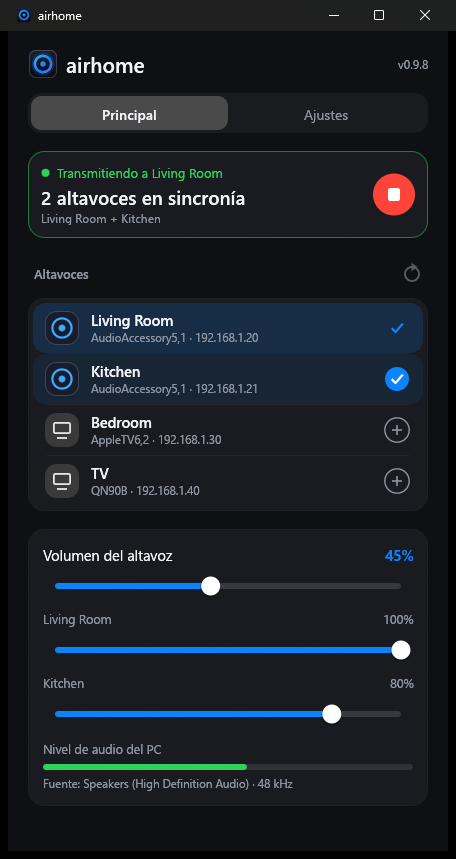
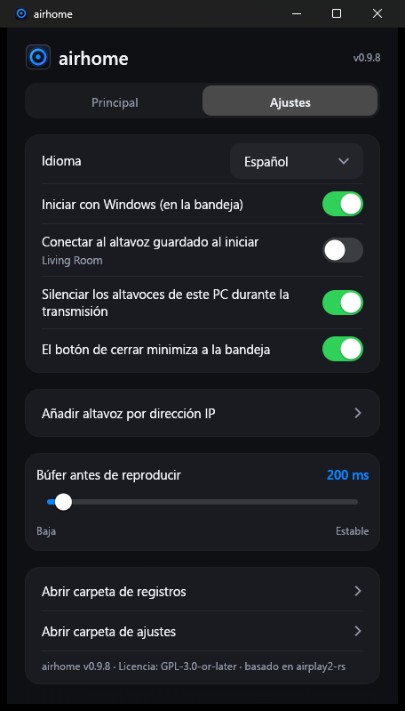

<p align="center">
  
</p>

<h1 align="center">airhome</h1>

<p align="center">
  <b>El sonido de Windows en tu HomePod, con un clic.</b><br>
  Una pequeña aplicación gratuita de la bandeja que envía todo lo que oyes en el PC a altavoces AirPlay 2.
</p>

<p align="center">
  
  
  
  
</p>

<p align="center">
  <a href="README.md">English</a> ·
  <a href="README.ru.md">Русский</a> ·
  <b>Español</b> ·
  <a href="README.de.md">Deutsch</a> ·
  <a href="README.fr.md">Français</a> ·
  <a href="README.pt.md">Português</a> ·
  <a href="README.zh.md">中文</a> ·
  <a href="README.ja.md">日本語</a>
</p>

<p align="center">
  
  &nbsp;&nbsp;
  
</p>

---

## Por qué airhome

Windows no tiene una forma integrada de enviar su sonido a un HomePod. airhome añade una que simplemente funciona:

- **Un clic, sin controladores.** Sin tarjeta de sonido virtual, sin Bonjour, sin iTunes. Elige un altavoz y pulsa conectar.
- **El sonido solo donde quieres.** Mientras transmite, los altavoces del PC se silencian y se restauran después
  — incluso si el programa se cierra de forma inesperada.
- **Varios altavoces a la vez.** Pulsa **+** junto a otros altavoces para reproducir en todos en sincronía, cada uno
  con su propio volumen *(experimental)*.
- **Vive en la bandeja.** Conecta, desconecta y cambia el volumen desde el menú de la bandeja sin abrir la ventana.
- **Se mantiene conectado.** Reconexión automática tras un fallo de Wi-Fi, un reintento si el inicio es lento, un botón
  para cancelar una conexión que tarda demasiado y una notificación si algo falla con la ventana oculta.
- **Pequeño y privado.** Un solo programa de 12 MB sin nada más que instalar. Sin cuenta, sin telemetría, sin
  comprobaciones de actualización, sin anuncios. Código abierto.
- **En tu idioma.** English, Русский, Español, Deutsch, Français, Português, 中文, 日本語.

## Características

| | |
|---|---|
| 🔊 **Audio del sistema** | Captura todo lo que reproduce Windows (WASAPI loopback) y lo envía como audio AirPlay 2 cifrado |
| 🏠 **Compatible con HomePod** | Emparejamiento transitorio de HomeKit, sincronización PTP precisa, funciona con HomePod mini |
| 🎚 **Volumen** | Volumen general más un nivel independiente para cada altavoz; también desde la bandeja |
| ⏱ **Retardo ajustable** | Búfer de 100 a 2000 ms: más bajo es más inmediato, más alto es más estable con Wi-Fi débil |
| 🔌 **Añadir por IP y puerto** | Para redes donde la detección automática no funciona (VLAN, algunos routers) |
| 🔁 **Reconexión automática** | Recupera la transmisión tras una caída; la conexión se puede cancelar en cualquier momento |
| 🔔 **Notificaciones** | Una notificación de Windows si falla una conexión mientras airhome está en la bandeja |
| 🚀 **Inicio con Windows** | Opcionalmente arranca oculto en la bandeja y se conecta a tu altavoz guardado |
| 🌍 **8 idiomas** | Se elige automáticamente según Windows; se cambia en Ajustes |

## Cómo funciona

```
  Sonido de Windows ──►  captura  ──►  codificar (ALAC) + cifrar  ──►  AirPlay 2  ──►  HomePod
  (lo que oyes)          (loopback)                                    (RTSP / RTP,
                                                                        reloj PTP)
```

airhome escucha el sonido que reproduce tu PC, lo comprime sin pérdida, lo cifra y lo transmite al altavoz por la
red local con el protocolo AirPlay 2. Si hay varios altavoces seleccionados, comparten un mismo reloj y suenan en
sincronía. Para evitar el sonido duplicado, la salida propia del PC se silencia mientras dura la transmisión.

## Instalación

1. Descarga **`airhome-setup-<versión>.exe`** desde la página *Releases* y ejecútalo (no requiere administrador).
2. Elige el idioma y los accesos directos que quieras. La entrada del menú Inicio se crea siempre.
3. Cuando lo pida, permite airhome en el **Firewall de Windows** para redes privadas; si no, no habrá sonido.

Requisitos: Windows 10 u 11 (64 bits), un HomePod u otro altavoz AirPlay 2 en la **misma red**, el acceso AirPlay en
«Todos en la misma red» y **sin contraseña de AirPlay** en el altavoz.

## Inicio rápido

1. Abre airhome. Tus altavoces aparecen en la lista.
2. Toca un altavoz y pulsa el botón redondo de **reproducir**.
3. Cierra la ventana: airhome sigue sonando desde la bandeja. Clic derecho en el icono para conectar, desconectar y volumen.

## Ajustes

| Ajuste | Qué hace |
|---|---|
| Idioma | Idioma de la interfaz |
| Iniciar con Windows | Arranca oculto en la bandeja al iniciar sesión |
| Conectar al altavoz guardado al iniciar | Se conecta solo; el nombre del altavoz aparece bajo el interruptor |
| Silenciar los altavoces de este PC durante la transmisión | Evita el sonido duplicado; se restaura solo después |
| El botón de cierre minimiza a la bandeja | Mantiene airhome en segundo plano |
| Añadir altavoz por dirección IP | Añade un altavoz a mano (IP y puerto opcional, por defecto 7000) |
| Búfer antes de reproducir | Control de latencia, 100–2000 ms (se aplica en la siguiente conexión) |

## Consejos

- **¿No aparece el altavoz?** Comprueba que está en la misma red y pulsa actualizar. Si tu red bloquea la
  detección, usa *Añadir altavoz por dirección IP*.
- **¿Sin sonido?** Asegúrate de que el Firewall de Windows permite airhome en redes privadas y de que el altavoz no
  tiene contraseña de AirPlay. Los filtros de red (por ejemplo, el controlador de red de AdGuard) pueden bloquear la conexión.
- **¿Importa el retardo (vídeo, juegos)?** Reduce el búfer. AirPlay siempre añade algo de retardo propio, así que
  para vídeo con sincronía labial conviene un búfer pequeño.
- **¿Cortes con Wi-Fi débil?** Aumenta el búfer.

## Estado

Desarrollado y probado en Windows 11 con un HomePod mini. Se espera que Windows 10 funcione, pero no se ha probado.
Reproducir en varios altavoces es **experimental**. Aún no hay compilaciones nativas para Windows en ARM ni Linux
(la versión x64 se ejecuta en ARM mediante la emulación de Windows, sin probar).

## El logotipo

<p align="center">
  
  &nbsp;
  
  &nbsp;
  
</p>

Un anillo luminoso con un punto en el centro: el sonido de un altavoz que se irradia desde una sola fuente. El anillo
refleja lo que hace airhome en la bandeja: **azul violeta** en reposo, **ámbar** al conectar y **verde** al transmitir.

## Compilar desde el código fuente

Requisitos: Windows, Rust (cadena MSVC). El repositorio espera el espacio de trabajo `airplay2-rs` modificado junto a
esta carpeta (`../airplay2-rs`).

```
cd airhome
cargo build --release
```

El ejecutable es `target\release\airhome.exe`. Para crear el instalador, instala
[Inno Setup 6](https://jrsoftware.org/isinfo.php) y ejecuta `iscc /DAppVersion=<versión> installer\airhome.iss`.

## Licencia

GPL-3.0-or-later — consulta [`LICENSE`](LICENSE) y [`NOTICE.md`](NOTICE.md). Basado en
[airplay2-rs](https://github.com/lmcgartland/airplay2-rs).

«AirPlay», «HomePod» y «Apple» son marcas registradas de Apple Inc. airhome es un proyecto independiente, sin
afiliación ni respaldo de Apple.
