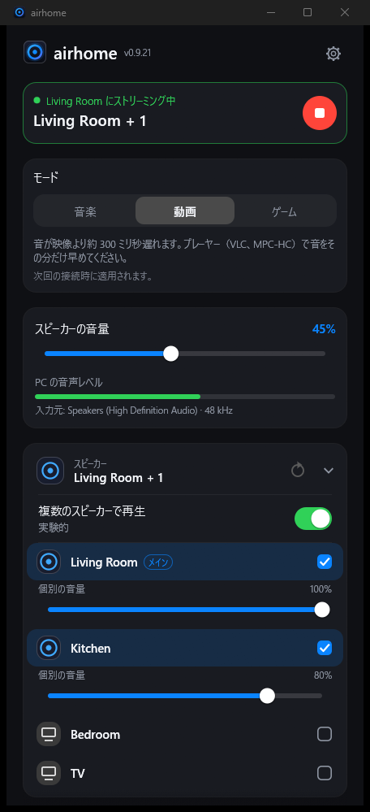
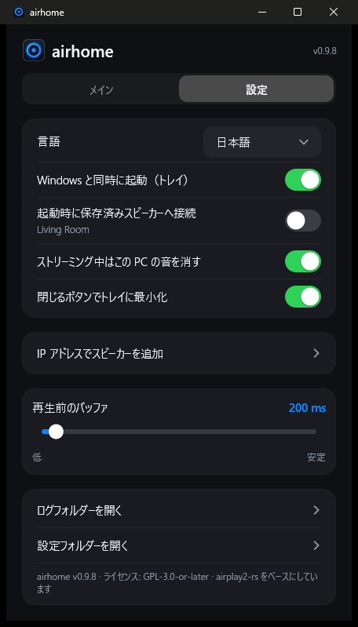

<p align="center">
  
</p>

<h1 align="center">airhome</h1>

<p align="center">
  <b>Windows の音を、ワンクリックで HomePod へ。</b><br>
  PC で聞こえるすべての音を AirPlay 2 対応スピーカーに送る、小さな無料のトレイアプリです。
</p>

<p align="center">
  
  
  
  
</p>

<p align="center">
  <a href="README.md">English</a> ·
  <a href="README.ru.md">Русский</a> ·
  <a href="README.es.md">Español</a> ·
  <a href="README.de.md">Deutsch</a> ·
  <a href="README.fr.md">Français</a> ·
  <a href="README.pt.md">Português</a> ·
  <a href="README.zh.md">中文</a> ·
  <b>日本語</b>
</p>

<p align="center">
  
  &nbsp;&nbsp;
  
</p>

---

## airhome の特長

Windows には、音を HomePod に送る標準機能がありません。airhome は、それをすぐに使える形で追加します。

- **ワンクリック、ドライバ不要。** 仮想サウンドカードも Bonjour も iTunes も不要。スピーカーを選んで接続するだけです。
- **音は必要な場所だけに。** ストリーミング中は PC 本体のスピーカーを自動でミュートし、終了後に元へ戻します。
  プログラムが予期せず終了した場合でも復元されます。
- **複数のスピーカーで同時再生。** 他のスピーカーの横の **+** をタップすると同期して再生し、音量もそれぞれ調整できます *（試験的）*。
- **トレイに常駐。** ウィンドウを開かずに、トレイのメニューから接続・切断・音量調整ができます。
- **つながり続ける。** Wi-Fi が一瞬切れても自動で再接続し、起動が遅いときは再試行し、長引く接続はキャンセルでき、
  ウィンドウを隠しているときに問題が起きれば通知します。
- **小さくてプライバシーに配慮。** 12 MB の単体プログラムで、追加のランタイムは不要。アカウント、テレメトリ、
  更新確認、広告はありません。オープンソースです。
- **あなたの言語で。** English、Русский、Español、Deutsch、Français、Português、中文、日本語。

## 機能

| | |
|---|---|
| 🔊 **システム音声** | Windows が再生するすべての音を取り込み（WASAPI loopback）、暗号化した AirPlay 2 音声として送信 |
| 🏠 **HomePod 対応** | HomeKit の一時ペアリング、正確な PTP 時刻同期、HomePod mini で動作 |
| 🎚 **音量** | 全体の音量に加えて、スピーカーごとの音量。トレイからも操作可能 |
| ⏱ **遅延の調整** | バッファを 100〜2000 ms で設定：小さいほど即時性が高く、大きいほど弱い Wi-Fi で安定 |
| 🔌 **IP とポートで追加** | 自動検出が機能しないネットワーク（VLAN、一部のルーター）向け |
| 🔁 **自動再接続** | 接続が切れてもストリームを復旧。接続中はいつでもキャンセル可能 |
| 🔔 **通知** | airhome がトレイにある間に接続が失敗した場合、Windows の通知でお知らせ |
| 🚀 **Windows と同時に起動** | 必要に応じてトレイに隠れた状態で起動し、保存したスピーカーに接続 |
| 🌍 **8 言語** | Windows の設定から自動選択。設定で変更も可能 |

## しくみ

```
  Windows の音 ──►  取り込み  ──►  エンコード (ALAC) + 暗号化  ──►  AirPlay 2  ──►  HomePod
  （聞こえる音）   (loopback)                                      (RTSP / RTP,
                                                                    PTP クロック)
```

airhome は PC が再生している音を取り込み、可逆圧縮して暗号化し、ローカルネットワーク経由で AirPlay 2 プロトコルを使って
スピーカーへストリーミングします。複数のスピーカーを選ぶと、同じクロックを共有して同期再生します。音が二重にならない
よう、ストリーミング中は PC 自体の出力をミュートします。

## インストール

1. [*Releases*](https://github.com/gmancode/airhome/releases/latest) ページから **`airhome-setup-<バージョン>.exe`** をダウンロードして実行します（管理者権限は不要）。
2. 言語と作成するショートカットを選びます。スタートメニューの項目は常に作成されます。
3. 確認が表示されたら、**Windows ファイアウォール**でプライベートネットワークへの airhome を許可してください。許可しないと音が出ません。

動作要件：Windows 10 または 11（64 ビット）、**同じネットワーク**にある HomePod などの AirPlay 2 スピーカー、AirPlay のアクセスを
「同じネットワーク上のすべての人」に設定し、スピーカーに **AirPlay パスワードを設定しない**こと。

## クイックスタート

1. airhome を開くと、スピーカーが一覧に表示されます。
2. スピーカーをタップし、丸い**再生**ボタンを押します。
3. ウィンドウを閉じても、airhome はトレイで再生を続けます。トレイのアイコンを右クリックすると、接続・切断・音量を操作できます。

## 設定

| 設定 | 内容 |
|---|---|
| 言語 | 画面表示の言語 |
| Windows と同時に起動 | サインイン時にトレイに隠れた状態で起動 |
| 起動時に保存済みスピーカーへ接続 | 自動で接続。スイッチの下にスピーカー名を表示 |
| ストリーミング中はこの PC の音を消す | 音の二重化を防ぎ、終了後に自動で元へ戻す |
| 閉じるボタンでトレイに最小化 | airhome をバックグラウンドで動かし続ける |
| IP アドレスでスピーカーを追加 | スピーカーを手動で追加（IP と任意のポート、既定は 7000） |
| 再生前のバッファ | 遅延スライダー、100〜2000 ms（次回の接続から反映） |

## ヒント

- **スピーカーが一覧にない？** 同じネットワークにあるか確認して、更新を押してください。ネットワークが検出をブロックしている場合は
  「IP アドレスでスピーカーを追加」を使います。
- **音が出ない？** Windows ファイアウォールがプライベートネットワークで airhome を許可しているか、スピーカーに AirPlay パスワードが
  ないか確認してください。ネットワークフィルター（例：AdGuard のネットワークドライバ）が接続を妨げることがあります。
- **遅延が気になる（動画、ゲーム）？** バッファを小さくしてください。AirPlay には常にある程度の遅延があるため、口の動きと
  音を合わせたい動画では小さめのバッファが最適です。
- **弱い Wi-Fi で音が途切れる？** バッファを大きくしてください。

## 状況

Windows 11 と HomePod mini で開発・テストしています。Windows 10 でも動作する見込みですが、未テストです。複数スピーカーでの再生は
**試験的**な機能です。Windows on ARM と Linux のネイティブ版はまだありません（x64 版は Windows のエミュレーションで ARM 上でも動く
見込みですが、未テストです）。

## ロゴについて

<p align="center">
  
  &nbsp;
  
  &nbsp;
  
</p>

中心に点がある光るリング：ひとつの音源から広がるスピーカーの音を表しています。トレイのリングの色は airhome の状態を示します：
待機中は**青紫**、接続中は**アンバー**、ストリーミング中は**緑**です。

## ソースからビルド

必要なもの：Windows、Rust（MSVC ツールチェーン）。このフォルダの隣（`../airplay2-rs`）に、修正済みの `airplay2-rs` ワークスペースが必要です。

```
cd airhome
cargo build --release
```

実行ファイルは `target\release\airhome.exe` です。インストーラーを作るには
[Inno Setup 6](https://jrsoftware.org/isinfo.php) をインストールし、`iscc /DAppVersion=<バージョン> installer\airhome.iss` を実行します。

## ライセンス

GPL-3.0-or-later。[`LICENSE`](LICENSE) と [`NOTICE.md`](NOTICE.md) を参照してください。
[airplay2-rs](https://github.com/lmcgartland/airplay2-rs) をベースにしています。

「AirPlay」「HomePod」「Apple」は Apple Inc. の商標です。airhome は独立したプロジェクトであり、Apple との提携や Apple による承認はありません。
